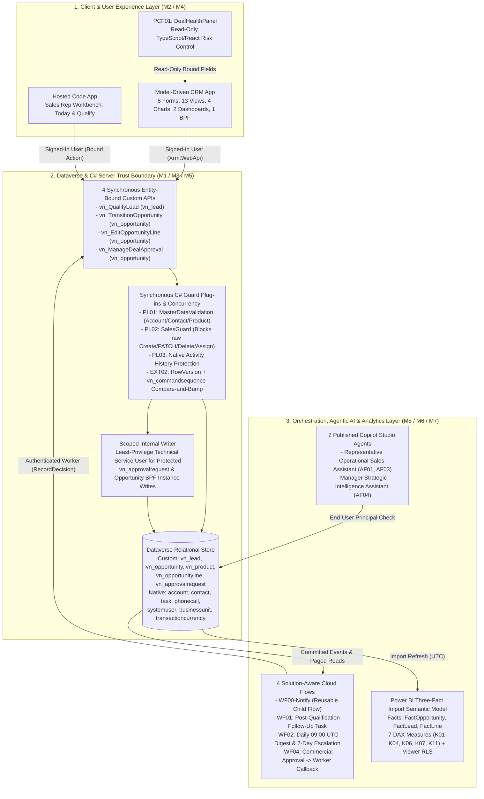

# Enterprise B2B Sales CRM — Microsoft Power Platform & C# Server Extensibility

**Author:** Ahmad Kassem — [GitHub](https://github.com/ak8x6) | [LinkedIn](www.linkedin.com/in/ak8x6)  
**Solution Name:** `VNEXTInternshipCRM` | **Publisher Prefix:** `vn` | **Base Currency:** `USD` (§1.1, §8.1) | **Time Zone Policy:** `UTC`  
**Tech Stack:** Microsoft Dataverse · C# (.NET Framework 4.6.2 Plug-ins & Custom APIs) · TypeScript / React (PCF & Power Apps Code Apps) · Model-Driven Power Apps · Power Automate · Microsoft Copilot Studio · Power BI (DAX & Row-Level Security) · Power Platform CLI (`pac`)

## 1. Project Overview

`VNEXTInternshipCRM` is an enterprise-grade, business-to-business (B2B) sales lifecycle and revenue governance platform engineered on Microsoft Power Platform. Rather than relying on fragile client-side scripts or asynchronous flows for business-critical logic, this architecture enforces a **Single Server Trust Boundary** where all lead conversions, stage transitions, product line pricing snapshots, concurrency locks, and approval workflows are governed by synchronous C# server-side code inside atomic Dataverse database transactions.

### Core Engineering Highlights

- **Transactional C# Custom APIs & Server Guards:** Four synchronous entity-bound Custom APIs (`vn_QualifyLead`, `vn_TransitionOpportunity`, `vn_EditOpportunityLine`, `vn_ManageDealApproval`) paired with synchronous PreValidation/PreOperation guard plug-ins (`PL01`–`PL03`) block unauthorized direct table mutations, enforce strict stage readiness gates, and guarantee atomic rollback on failure.
- **Optimistic Concurrency & Idempotency:** Parent-level `RowVersion` compare-and-bump coordination (`vn_commandsequence`) serializes competing line-item edits, stage closures, and approval decisions, while active database Alternate Keys (`vn_originatinglead`, `vn_sku`, `vn_automationkey`) prevent duplicate deal conversions and duplicate automated tasks.
- **Immutable Commercial Snapshots & Exact Financial Math:** Opportunity Lines snapshot catalog SKU, product name, and 4-decimal unit price at the moment of addition, computing `Gross`, `DiscountAmount`, `Net`, `Total`, and `MaxDiscount` server-side using `MidpointRounding.AwayFromZero` arithmetic—automatically invalidating prior approvals whenever commercial terms change.
- **Multi-Persona RBAC & Scoped Impersonation:** Role-based access control across sibling Business Units (`Sales A` and `Sales B`) separates `Sales Representative`, `Sales Manager`, `Sales Administrator`, and `Automation Worker` privileges, using a least-privilege **Scoped Internal Writer** service identity for protected approval-request and BPF-instance mutations.
- **Full-Stack Extensibility (PCF, Code App, AI Agents & BI):** Includes a read-only React/TypeScript `DealHealthPanel` PCF control, a hosted two-screen (`Today` and `Qualify`) React Code App, four solution-aware Power Automate cloud flows, two grounded Microsoft Copilot Studio agents, and a three-fact Star-Schema Power BI semantic model with `CRMViewer` Row-Level Security (RLS).

## 2. System Architecture



## 3. End-to-End Architecture by Layer (`M0`–`M8`)

### 3.1 Relational Data Model & Alternate Keys (`M1`)

- **Custom Tables (`vn_`):**
  - `vn_lead` (_User/Team_): Captures inbound B2B interest (`New` → `Contacted` → `Qualified` / `Disqualified`), qualification readiness predicates, and immutable conversion result lookups (`vn_account`, `vn_contact`, `vn_opportunity`, `vn_qualifiedon`).
  - `vn_opportunity` (_User/Team_): Governs active deals across adjacent forward stages (`Qualify 10%` → `Develop 30%` → `Propose 60%` → `Close 90%` → `Won 100%` / `Lost 0%`), server-computed totals (`vn_total`, `vn_maxdiscount`), concurrency sequence (`vn_commandsequence`), and current approval pointer (`vn_currentapproval`).
  - `vn_product` (_Organization_): Administrator-managed product catalog with 4-decimal base-currency unit pricing (`vn_unitprice`) and an active unique Alternate Key on uppercase `vn_sku`.
  - `vn_opportunityline` (_User/Team_): Deal-specific line items storing immutable product snapshots (`vn_snapshotsku`, `vn_snapshotname`, `vn_unitprice`) and server-calculated `Gross`, `Discount`, and `Net` amounts.
  - `vn_approvalrequest` (_User/Team_): Immutable audit record of submitted commercial approvals (`Pending`, `Approved`, `Rejected`, `Superseded`, `Cancelled`) with server-resolved manager snapshots (`vn_approver`, `vn_dealowner`).
- **Native Platform Tables & Keys:** Reuses `account`, `contact`, `task`, and `phonecall` with `Restrict` delete behavior and active unique Alternate Keys on `vn_opportunity.vn_originatinglead` and `task.vn_automationkey`.

### 3.2 Model-Driven UX & Role-Based Security (`M2`)

- **Business Unit Isolation:** Two sibling Business Units (`Sales A` and `Sales B`) enforce strict horizontal data isolation between sales teams while allowing organization-wide `Account` and `Contact` read access for explicit customer reuse.
- **Role-Tailored Workspace:** Includes 8 custom/native forms, 1 server-mirrored Opportunity Business Process Flow (`Qualify → Develop → Propose → Close`), 13 system views (`V01`–`V17`), 4 native charts (`C01`, `C03`, `C04`, `C06`), and 2 six-component standard dashboards (`Rep Workspace` and `Manager Overview`).

### 3.3 C# Custom APIs, Guard Plug-ins & Concurrency (`M3`)

- **`EXT10` (`vn_QualifyLead`):** Converts an eligible `Contacted` Lead into an Opportunity in a single atomic transaction across three explicit customer paths (reuse Account + Contact, reuse Account + create Contact, or create both), initializing the Opportunity BPF instance and locking out duplicate conversions via `vn_originatinglead`.
- **`EXT11` (`vn_TransitionOpportunity`):** Enforces stage-entry prerequisites (`Develop`, `Propose`, `Close`), synchronizes probability and the BPF stage, and validates `Won` (requiring a current `Approved` request when `Total >= 50,000` or `MaxDiscount > 10%`) and `Lost` closures.
- **`EXT12` (`vn_EditOpportunityLine`):** Executes `Add` (with client-generated stable GUID and catalog snapshot) and `Remove` operations, recalculating deal totals and atomically superseding/clearing any prior `vn_currentapproval` pointer.
- **`PL01`–`PL03` Guards & `EXT02` Latch:** Rejects direct `vn_opportunity` creation, direct `vn_opportunityline` CRUD, unauthorized field/stage patches, and edits to closed deals or completed activities.

### 3.4 PCF Control & Hosted Code App (`M4`)

- **`PCF01` (`DealHealthPanel`):** Read-only TypeScript/React control bound to Opportunity summary fields, evaluating deterministic risk reasons (Expected Close overdue, Last Progress > 14 UTC days, Next Follow-Up overdue) with full keyboard and screen-reader accessibility.
- **`CA01`/`CA02` (Sales Rep Workbench Code App):** Hosted two-screen React application providing paged `Today` queues and a dedicated `Qualify` workflow invoking `EXT10` under the signed-in user's Dataverse identity.

### 3.5 Cloud Flows & Commercial Approval (`M5`)

- **`EXT13` (`vn_ManageDealApproval`) & `WF04`:** Resolves the deal owner's native `systemuser.parentsystemuserid` Manager on `Submit`, dispatches a real Power Automate Approvals request via `WF04`, and records the verified Manager decision via the restricted `Automation Worker` identity.
- **Automated Task & Digest Orchestration:** `WF01` creates an idempotent post-qualification follow-up Task (`postqual:{LeadGUID}`), `WF02` runs daily at `09:00 UTC` to send owner digests and escalate items `>= 7` days overdue, and `WF00-Notify` centralizes internal notification delivery.

### 3.6 Copilot Studio Agents & Power BI Analytics (`M6` & `M7`)

- **Two Grounded Copilot Studio Agents (`M6`):** _Representative Operational Sales Assistant_ (Opportunity summary, DNC-aware follow-up draft, and explicit-confirmation Task creation via `AF01`/`AF03`) and _Manager Strategic Intelligence Assistant_ (team pipeline, deterministic at-risk deals, and coaching suggestions via `AF04`).
- **Three-Fact Power BI Semantic Model (`M7`):** Import-mode `PBIX` modeling `FactOpportunity`, `FactLead`, and `FactLine` across `DimDate`, `DimRepresentative`, and `DimAccount`, implementing 7 DAX measures (`K01`–`K04`, `K06`, `K07`, `K11`), drillthrough `Deal Detail`, and dynamic `CRMViewer` Row-Level Security (`SecurityMap`).

## 4. Living Milestone Progression Tracker (`M0`–`M8`)

> _Update the status badges and checkboxes below as each milestone is completed and tagged in Git._

| Milestone | Scope                                                                          | Status        | Git Tag                    |
| :-------- | :----------------------------------------------------------------------------- | :------------ | :------------------------- |
| **M0**    | **Engineering Readiness, Solution & CLI Pipeline**                             | **Completed** | `m0-engineering-readiness` |
| **M1**    | **Dataverse Relational Schema, Choices & Alternate Keys**                      | **Completed** | `m1-data-foundation`       |
| **M2**    | **Model-Driven App, 13 Views, 4 Charts, 2 Dashboards & RBAC**                  | **Completed** | `m2-model-driven-crm`      |
| **M3**    | **C# Custom APIs (`EXT10`–`12`), Guard Plug-ins (`PL01`–`03`) & Concurrency**  | Pending       | `m3-transactional-crm`     |
| **M4**    | **Read-Only `DealHealthPanel` PCF & Hosted 2-Screen Code App**                 | Pending       | `m4-pcf-codeapp`           |
| **M5**    | **Approval API (`EXT13`) & 4 Solution-Aware Cloud Flows (`WF00`–`04`)**        | Pending       | `m5-flows-approval`        |
| **M6**    | **2 Published Copilot Studio Agents & 3 Agent Flows (`AF01`, `AF03`, `AF04`)** | Pending       | `m6-copilot-agents`        |
| **M7**    | **3-Fact Power BI Import Model, 7 DAX Measures & `CRMViewer` RLS**             | Pending       | `m7-powerbi-analytics`     |
| **M8**    | **Clean Target Import, End-to-End Verification & Release Handover**            | Pending       | `m8-final-release`         |

### Milestone Deliverable Checklists

- [x] **M0 — Engineering Readiness:** Publisher `vn`, unmanaged/managed solution `VNEXTInternshipCRM`, 5 policy environment variables (`vn_ApprovalAmount`, `vn_ApprovalDiscount`, `vn_MaxDiscount`, `vn_StaleDays`, `vn_EscalationDays`), PAC CLI unpack pipeline, and architecture documentation.
- [x] **M1 — Data Foundation:** 5 custom tables (`vn_lead`, `vn_opportunity`, `vn_product`, `vn_opportunityline`, `vn_approvalrequest`), native `account`/`contact`/`task` extensions, 3 active Alternate Keys, `Restrict` relationship cascades, explicit Money precision, and annotated ERD.
- [x] **M2 — Model-Driven CRM & Security:** `Sales A` and `Sales B` Business Units, `Sales Rep` / `Sales Manager` / `Sales Administrator` security roles (with verified baseline UCI app/chart privileges), `DM14` auditing governance, 8 forms, 13 system views (`V01`–`V03`, `V05`–`V06`, `V08`–`V11`, `V14`–`V17`), 4 charts, 2 six-slot dashboards, Opportunity BPF, 2 Guidance Business Rules, and command bar dialog wiring.
- [ ] **M3 — Transactional C# Extensibility:** Signed `.NET Framework 4.6.2` plug-in assembly implementing `EXT10`, `EXT11`, `EXT12`, `PL01`–`PL03` guards, `RowVersion` + `vn_commandsequence` concurrency latch, and `Scoped Internal Writer` impersonation.
- [ ] **M4 — Rich UI & Hosted Code App:** Deployed `DealHealthPanel` PCF control (`PCF01`) and hosted two-screen Sales Rep Workbench Code App (`CA01` Today / `CA02` Qualify).
- [ ] **M5 — Cloud Flows & Commercial Approval:** `EXT13` (`Submit`, `RecordDecision`, `Cancel`) and 4 solution-aware flows (`WF00-Notify`, `WF01`, `WF02`, `WF04`) with real Approvals connector integration.
- [ ] **M6 — Copilot Studio Agents:** Published Rep and Manager agents with authenticated end-user Dataverse tools (`AF01`, `AF03`, `AF04`) and prompt-injection/DNC safeguards.
- [ ] **M7 — Power BI Analytics:** Three-fact Import `PBIX`, 7 DAX measures (`K01`–`K04`, `K06`, `K07`, `K11`), 2 visible + 1 drillthrough page, and verified `CRMViewer` RLS.
- [ ] **M8 — Final Release & Handover:** Reproducible clean-environment import, positive/negative persona test evidence, and release runbook.

## 5. Repository Structure & Build Workflow

```text
VNEXTInternshipCRM/
├── docs/                           # Architecture diagrams, ERD, and milestone verification docs
│   ├── M0_Engineering_Readiness.md
│   ├── M1_Data_Foundation.md
│   ├── M2_Model_Driven_CRM.md
│   └── DATA_INVENTORY.md           # Master record inventory (Accounts, Contacts, Leads, Products, Personas)
├── scripts/                        # PAC CLI export, unpack, pack, and solution-checker scripts
│   └── sync-solution.ps1
├── solutions/
│   └── VNEXTInternshipCRM/         # Unpacked Dataverse solution XML (Unmanaged & Managed)
├── src/
│   ├── codeapp/                    # M4 Hosted Sales Rep Workbench (React / TypeScript)
│   ├── pcf/                        # M4 DealHealthPanel PCF control (TypeScript / React)
│   ├── plugins/                    # M3/M5 C# Plug-ins & Custom APIs (.NET Framework 4.6.2)
│   └── webresources/               # M2/M3 Model-driven form scripts & command dialogs
├── .gitignore
└── README.md
```

### Fixed Policy Environment Variables

| Schema Name           | Type    | Default | Description                                                                      |
| :-------------------- | :------ | ------: | :------------------------------------------------------------------------------- |
| `vn_ApprovalAmount`   | Decimal | `50000` | Minimum Opportunity `Total` (base currency `USD`) requiring Manager approval     |
| `vn_ApprovalDiscount` | Decimal |    `10` | Line discount percentage threshold (`> 10.00%`) requiring Manager approval       |
| `vn_MaxDiscount`      | Decimal |    `30` | Maximum permitted discount percentage (`30.00%`) on any Opportunity Line         |
| `vn_StaleDays`        | Decimal |    `14` | UTC days without explicit business progress before an Open deal is flagged Stale |
| `vn_EscalationDays`   | Decimal |     `7` | UTC days overdue before open work escalates to the owner's Manager               |

### Reproducible CLI Commands

```powershell
# 1. Authenticate PAC CLI to target Dataverse environment
pac auth create --name "VNEXT-Dev" --environment "https://<your-org>.crm.dynamics.com/"
pac auth select --name "VNEXT-Dev"

# 2. Export Unmanaged & Managed solutions and unpack XML to source control
.\scripts\sync-solution.ps1

# 3. Pack solution from source control and import into target environment
pac solution pack --zipfile "./.artifacts/VNEXTInternshipCRM_unmanaged.zip" --folder "./solutions/VNEXTInternshipCRM" --packagetype Both
pac solution import --path "./.artifacts/VNEXTInternshipCRM_unmanaged.zip" --publish-changes true
```

## 6. Data Privacy, Security & Synthetic-Data Standards

- **100% Synthetic B2B Dataset:** All customer organizations, contacts, leads, products, and commercial transactions in this repository use synthetic test records (`@example.com`) with zero real-world personally identifiable information (PII).
- **Zero Secrets in Source Control:** No Entra ID client secrets, credentials, environment URLs, or user GUIDs are stored in source code, JavaScript web resources, or browser bundles. All environment-specific bindings use Dataverse Environment Variables and Connection References.
