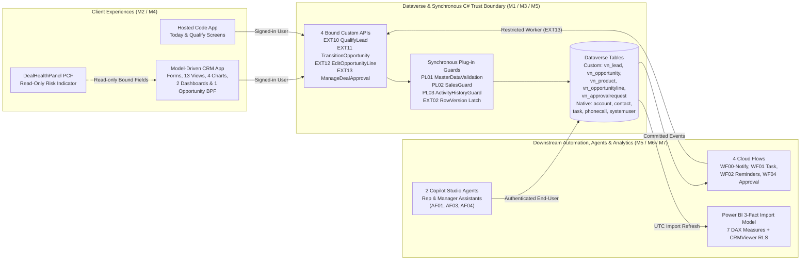

# M0 Engineering Readiness — Environment, Governance & Toolchain Inventory

**Solution Name:** `VNEXTInternshipCRM`  
**Publisher:** `VNEXT Internship` (`VNEXTInternship`) | **Prefix:** `vn` (`OptionValuePrefix: 12744`)  
**Milestone:** `M0 — Engineering Readiness (W1)`  
**Git Tag:** `m0-engineering-readiness`  

---

## 1. Environment & Platform Baseline (§1.1 & §8.1)

| Capability / Policy | Verified Configuration |
| :--- | :--- |
| **Environment Type & Region** | Power Apps **Developer** Environment (`Europe / Switzerland`), Managed Environment enabled |
| **Installed App Baseline** | Standard Dataverse core schema (`OrganizationSchemaType = Standard`, `v9.2`); Dynamics 365 Sales is **not** installed (custom `vn_lead`, `vn_opportunity`, `vn_product`, `vn_opportunityline`, `vn_approvalrequest` own the sales domain per `DM01`–`DM03`) |
| **Base Currency** | **`USD`** (`US Dollar`, `$`) — standard currency precision `2`; Product & Opportunity Line `vn_unitprice` use explicit attribute-level precision `4` (`PrecisionSource = 0`). Foreign-currency commercial writes are rejected per `§1.1` |
| **UTC & Date Policy** | Server timestamps use `TimeZoneIndependent` UTC; `Today` calculations and `09:00 UTC` scheduled flows use UTC; business calendar dates (`vn_expectedclosedate`, `vn_nextfollowupdate`, `vn_buyingtargetdate`, `vn_actualclosedate`) use `DateOnly` without time-zone offset shift; native `task`/`phonecall` `scheduledstart`/`scheduledend` retain `UserLocal` display |
| **Source-Controlled Solution** | Unmanaged development solution `VNEXTInternshipCRM` exported as both Unmanaged and Managed packages into `.artifacts/` (git-ignored) and unpacked via `pac solution unpack` into `solutions/VNEXTInternshipCRM/` |
| **Authenticated Developer Toolchain** | Git `2.52`, Power Platform CLI (`pac 2.13.1`, profile `VNEXT-Dev`), .NET SDK `10.0` + `.NET Framework 4.6.2 Developer Pack` (`net462` for Dataverse plug-in assemblies), Node.js `v22.15` + `npm 11.12` (for M4 PCF & Code App) |

---

## 2. Fixed Business Policy Environment Variables (§1.1)

All five policy thresholds are provisioned as Dataverse `Decimal` (`100000001`) Environment Variable Definitions inside `VNEXTInternshipCRM`:

| Schema Name | Display Name | Type | Default Value | Governing Rule (§1.1) |
| :--- | :--- | :--- | ---: | :--- |
| `vn_ApprovalAmount` | Approval Amount | Decimal (`100000001`) | `50000` | Deal `Total >= 50,000` base currency (`USD`) triggers Manager approval (`BR20`) |
| `vn_ApprovalDiscount` | Approval Discount | Decimal (`100000001`) | `10` | Any saved Opportunity Line `DiscountPercent > 10.00%` triggers Manager approval (`BR20`; exact `10.00%` alone does not) |
| `vn_MaxDiscount` | Max Discount | Decimal (`100000001`) | `30` | Maximum allowed discount (`30.00%`) on any Opportunity Line (`BR15`/`BR17`) |
| `vn_StaleDays` | Stale Days | Decimal (`100000001`) | `14` | Open deal flagged at-risk (`Stale`) when `vn_lastprogresson` is more than `14` UTC days old (`BR30`) |
| `vn_EscalationDays` | Escalation Days | Decimal (`100000001`) | `7` | Open due work `>= 7` UTC days overdue escalates to the owner's native Manager at `09:00 UTC` (`BR28`/`WF02`) |

---

## 3. High-Level Sales & Data Architecture Diagram (§8.1)

---

## 4. Environment Eligibility Checklist, Unresolved Dependencies & Continuity Risks (§8.1)

| Area / Milestone | Readiness Status | Dependency / Continuity Risk & Mitigation |
| :--- | :---: | :--- |
| **Dataverse Core, Custom Tables & Alternate Keys (`M1`)** | **Ready** | Provisioned in dedicated Developer environment; async system index jobs verified active. |
| **Model-Driven App, BPF & Sibling BU RBAC (`M2`)** | **Ready** | Requires provisioning distinct non-admin test user identities across sibling Business Units (`Sales A`, `Sales B`) plus `Sales Administrator` so role tests never run under `System Administrator`. |
| **C# Plug-ins, Custom APIs & Scoped Internal Writer (`M3`)** | **Ready** | `.NET Framework 4.6.2` SDK verified locally. Requires provisioning a dedicated, enabled, least-privilege internal service `systemuser` (`SR03`/`EXT03`) for `CreateOrganizationService(configuredUserId)`. |
| **PCF & Hosted Power Apps Code App (`M4`)** | **Dependency Tracked** | Verify **Power Apps component framework for canvas apps** toggle and **Power Apps Code Apps** host availability in Power Platform Admin Center prior to Week 7. |
| **Cloud Flows, Approvals & Worker Identity (`M5`)** | **Dependency Tracked** | Requires initializing the Power Automate **Approvals** solution in the environment and provisioning a dedicated `Automation Worker` user principal mapped via `vn_AutomationWorkerId`. |
| **Copilot Studio Published Agents (`M6`)** | **Dependency Tracked** | Requires Copilot Studio maker + end-user channel publishing entitlement in the tenant; verify trial/license availability prior to Week 10 and document any tenant-level publishing restriction transparently if encountered. |
| **Power BI Service Import Refresh & Viewer RLS (`M7`)** | **Dependency Tracked** | Power BI Desktop authoring is available locally; Power BI Service workspace publishing and real `Viewer` role RLS testing require Power BI Pro/trial seat assignment for test viewers. |
| **M365 Trial Continuity (`M0`–`M8`)** | **Mitigated** | Microsoft 365 E3 trial extended through **20 December 2026** (covering the 13-week program); `sync-solution.ps1` exports full Unmanaged/Managed solution packages after every milestone so the entire solution can be cleanly re-imported if tenant migration is ever needed. |

---

## 5. Synthetic-Data & Secret-Hygiene Policy (§8.1)

1. **100% Synthetic Data:** Every seeded or test Account, Contact, Lead, Product, Opportunity, and Activity uses fictional B2B company names (e.g., *Cedar Manufacturing*, *Alpine Logistics AG*) and reserved `@example.com` email addresses—never real customer or personal PII.
2. **Zero Credentials or Tenant Secrets in Git:** Client secrets, passwords, tokens, private environment URLs, and environment-specific user GUIDs are strictly excluded from Git (`.gitignore` excludes `.artifacts/`, `*.env`, `*.pfx`, `*.snk`, and private local notes). Runtime configuration uses Dataverse Environment Variables and Connection References.
3. **Role-Separation Discipline:** The Maker / Platform Administrator identity builds and deploys customizations, while functional/security tests in `M2`–`M8` execute under dedicated non-admin business personas (`Sales Rep`, `Sales Manager`, `Sales Administrator`, `Automation Worker`, `CRMViewer`).
