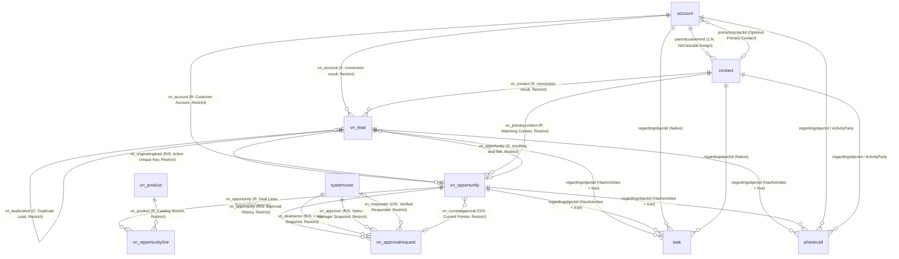

# M1 Data Foundation — Technical Architecture, Data Dictionary & Runtime Verification

**Solution Name:** `VNEXTInternshipCRM`  
**Publisher:** `VNEXT Internship` (`VNEXTInternship`) | **Prefix:** `vn`  
**Milestone:** `M1 — Data Foundation (W2)`  
**Git Tag:** `m1-data-foundation`  
**Status:** **Completed & Verified**  

---

## 1. Annotated Entity-Relationship Diagram (ERD)

The core relational domain uses five custom tables (`vn_lead`, `vn_opportunity`, `vn_product`, `vn_opportunityline`, `vn_approvalrequest`) paired with four native Dataverse business tables (`account`, `contact`, `task`, `phonecall`) plus platform `systemuser`, `businessunit`, `transactioncurrency`, `activitypointer`, and `activityparty`.

---

## 2. Relationship & Cascade Matrix (§4.7)

All 14 custom `1:N` relationships enforce **`Delete = Restrict`** with **`NoCascade`** across `Assign`, `Reparent`, `Share`, and `Unshare`. Native `contact_customer_accounts` (`Account -> Contact`) is configured to **`NoCascade`** on `Assign`, `Reparent`, `Share`, and `Unshare` so reused customers never cascade sales-ownership transfers.

| Relationship Schema Name | Parent (`1`) | Child (`N`) | Lookup Attribute | Delete | Assign | Reparent | Share / Unshare |
| :--- | :--- | :--- | :--- | :--- | :--- | :--- | :--- |
| `vn_account_vn_lead` | `account` | `vn_lead` | `vn_account` | **Restrict** | NoCascade | NoCascade | NoCascade |
| `vn_contact_vn_lead` | `contact` | `vn_lead` | `vn_contact` | **Restrict** | NoCascade | NoCascade | NoCascade |
| `vn_lead_duplicateof_vn_lead` | `vn_lead` | `vn_lead` | `vn_duplicateof` | **Restrict** | NoCascade | NoCascade | NoCascade |
| `vn_opportunity_vn_lead_resulting` | `vn_opportunity` | `vn_lead` | `vn_opportunity` | **Restrict** | NoCascade | NoCascade | NoCascade |
| `vn_account_vn_opportunity` | `account` | `vn_opportunity` | `vn_account` | **Restrict** | NoCascade | NoCascade | NoCascade |
| `vn_contact_vn_opportunity_primary` | `contact` | `vn_opportunity` | `vn_primarycontact` | **Restrict** | NoCascade | NoCascade | NoCascade |
| `vn_lead_vn_opportunity_originating` | `vn_lead` | `vn_opportunity` | `vn_originatinglead` | **Restrict** | NoCascade | NoCascade | NoCascade |
| `vn_vn_approvalrequest_vn_opportunity` | `vn_approvalrequest` | `vn_opportunity` | `vn_currentapproval` | **Restrict** | NoCascade | NoCascade | NoCascade |
| `vn_opportunity_vn_opportunityline` | `vn_opportunity` | `vn_opportunityline` | `vn_opportunity` | **Restrict** | NoCascade | NoCascade | NoCascade |
| `vn_product_vn_opportunityline` | `vn_product` | `vn_opportunityline` | `vn_product` | **Restrict** | NoCascade | NoCascade | NoCascade |
| `vn_vn_opportunity_vn_approvalrequest` | `vn_opportunity` | `vn_approvalrequest` | `vn_opportunity` | **Restrict** | NoCascade | NoCascade | NoCascade |
| `vn_systemuser_vn_approvalrequest_dealowner` | `systemuser` | `vn_approvalrequest` | `vn_dealowner` | **Restrict** | NoCascade | NoCascade | NoCascade |
| `vn_systemuser_vn_approvalrequest_approver` | `systemuser` | `vn_approvalrequest` | `vn_approver` | **Restrict** | NoCascade | NoCascade | NoCascade |
| `vn_systemuser_vn_approvalrequest_responder` | `systemuser` | `vn_approvalrequest` | `vn_responder` | **Restrict** | NoCascade | NoCascade | NoCascade |
| `contact_customer_accounts` *(Native)* | `account` | `contact` | `parentcustomerid` | System Cascade\* | **NoCascade** | **NoCascade** | **NoCascade** |
| `account_primary_contact` *(Native)* | `contact` | `account` | `primarycontactid` | RemoveLink | NoCascade | NoCascade | NoCascade |
| `vn_lead_Tasks` / `vn_lead_PhoneCalls` | `vn_lead` | `task` / `phonecall` | `regardingobjectid` | System Cascade\* | Cascade | Cascade | Cascade |
| `vn_opportunity_Tasks` / `vn_opportunity_PhoneCalls` | `vn_opportunity` | `task` / `phonecall` | `regardingobjectid` | System Cascade\* | Cascade | Cascade | Cascade |

*\*See Section 8 for verified platform system-relationship constraints (`0x80048203`) and security-role/plug-in protections (`–` Delete privilege across all business roles + `PL01`/`PL02`/`PL03`).*

---

## 3. Base-Currency, Money Precision & UTC Date Configuration (§1.1 & §4.1)

- **Base Currency:** `USD` (`US Dollar`, `$`), standard currency precision = **`2`** (`transactioncurrency.currencyprecision = 2`).
- **Explicit Attribute-Level Money Scales (`PrecisionSource = 0`):** Every custom `Money` column uses `PrecisionSource = 0` (*Attribute Precision*) rather than inheriting currency precision, guaranteeing deterministic `4`-decimal storage on `vn_product.vn_unitprice` and `vn_opportunityline.vn_unitprice` and `2`-decimal storage on all commercial totals, line amounts, budgets, and approval snapshots across clean target imports.
- **UTC & Date Semantics:**
  - Server event timestamps (`vn_qualifiedon`, `vn_disqualifiedon`, `vn_lastprogresson`, `vn_stageenteredon`, `vn_submittedon`, `vn_respondedon`) use `DateAndTime` + **`TimeZoneIndependent`** (pure UTC without client offset shifts).
  - Business calendar dates (`vn_nextfollowupdate`, `vn_buyingtargetdate`, `vn_expectedclosedate`, `vn_actualclosedate`) use `DateOnly` + **`DateOnly`**.
  - Native activity schedule fields (`task.scheduledstart`, `task.scheduledend`, `phonecall.scheduledstart`, `phonecall.scheduledend`) retain platform **`UserLocal`** behavior.

---

## 4. Complete Data Dictionary (§4.1–§4.7)

**Duty / Requiredness Legend (§1):**
- **`R`** = Always Required (`ApplicationRequired` in Dataverse metadata + server validation)
- **`C`** = Conditionally Required at a named transition (`Optional` in metadata so initial capture works; enforced by C# server logic)
- **`O`** = Optional
- **`S`** = Server-Set / Protected (`Optional` or `ApplicationRequired` per creation route; protected against ordinary client writes by `PL02`)

---

### 4.1 Custom Table 1: `vn_lead` (`DM04` — Prospect & Qualification Outcome)
- **Primary Key / Primary Name:** `vn_leadid` (GUID) / `vn_name` (`Topic`, Text 200, `R`)
- **Ownership:** `UserOwned` (`ownerid`, `owningbusinessunit`)
- **Capabilities:** `IsAuditEnabled = true`, `HasActivities = true`, `IsActivityParty = false`, `IsBusinessProcessEnabled = false`
- **State & Status Reason (`statecode` / `statuscode`):**
  - `Active = 0`: **`New = 100000000`** *(Default)*, **`Contacted = 100000001`**
  - `Inactive = 1`: **`Qualified = 100000002`** *(Default Inactive)*, **`Disqualified = 100000003`** *(leftover OOB codes `1`/`2` removed)*

| Logical Name | Display Name | Dataverse Type & Constraints | Metadata Required | Spec Duty | Choices / Target / Notes |
| :--- | :--- | :--- | :---: | :---: | :--- |
| `vn_name` | Topic | `String` (`Text`, Max `200`) | Business Required | `R` | Nonblank Lead topic |
| `vn_firstname` | First Name | `String` (`Text`, Max `80`) | Optional | `O` | Optional prospect first name |
| `vn_lastname` | Last Name | `String` (`Text`, Max `100`) | Business Required | `R` | Nonblank prospect last name |
| `vn_companyname` | Company Name | `String` (`Text`, Max `160`) | Optional | `C` | Required nonblank at qualification (`BR03`) |
| `vn_email` | Email | `String` (`Email`, Max `254`) | Optional | `C` | Email or Phone required while Open (`BR01`) |
| `vn_phone` | Phone | `String` (`Phone`, Max `50`) | Optional | `C` | Email or Phone required while Open (`BR01`) |
| `vn_source` | Source | `Picklist` (Local Choice) | Business Required | `R` | `100000000`=Website, **`100000001`=Referral (Default)**, `100000002`=Cold Call, `100000003`=Event |
| `vn_rating` | Rating | `Picklist` (Local Choice) | Business Required | `R` | `100000000`=Hot, **`100000001`=Warm (Default)**, `100000002`=Cold |
| `vn_need` | Business Need | `Memo` (Multiline, Max `2000`) | Optional | `C` | Nonblank required to qualify (`BR03`) |
| `vn_nextstep` | Next Step | `String` (`Text`, Max `500`) | Optional | `C` | Nonblank required on Contacted & qualification (`BR02`/`BR03`) |
| `vn_budget` | Budget | `Money` (`Precision = 2`, `PrecisionSource = 0`, `0`–`1,000,000,000`) | Optional | `O` | Nonnegative if supplied; unknown remains `null` |
| `vn_buyingtargetdate` | Buying Target Date | `DateTime` (`DateOnly` / `DateOnly`) | Optional | `O` | Informational target date |
| `vn_nextfollowupdate` | Next Follow-up Date | `DateTime` (`DateOnly` / `DateOnly`) | Business Required | `R` (Open) | Required on Open Leads (`BR01`/`BR02`) |
| `vn_disqualificationreason` | Disqualification Reason | `Picklist` (Local Choice) | Optional | `C` | `100000000`=No Fit, `100000001`=No Budget, `100000002`=No Response, `100000003`=Duplicate |
| `vn_disqualificationcomments` | Disqualification Comments | `Memo` (Multiline, Max `2000`) | Optional | `C` | Trimmed nonblank on Disqualified (`BR07`) |
| `vn_duplicateof` | Duplicate Of | `Lookup` -> `vn_lead` (`Restrict`) | Optional | `C` | Required only when reason = `Duplicate`, never self |
| `vn_account` | Account | `Lookup` -> `account` (`Restrict`) | Optional | `S` | Populated atomically on `EXT10` qualification |
| `vn_contact` | Contact | `Lookup` -> `contact` (`Restrict`) | Optional | `S` | Populated atomically on `EXT10` qualification |
| `vn_opportunity` | Resulting Opportunity | `Lookup` -> `vn_opportunity` (`Restrict`) | Optional | `S` | Populated atomically on `EXT10` qualification |
| `vn_qualifiedon` | Qualified On | `DateTime` (`DateAndTime` / `TimeZoneIndependent`) | Optional | `S` | Server UTC timestamp on `Qualified` |
| `vn_disqualifiedon` | Disqualified On | `DateTime` (`DateAndTime` / `TimeZoneIndependent`) | Optional | `S` | Server UTC timestamp on `Disqualified` |

---

### 4.2 Custom Table 2: `vn_opportunity` (`DM06` — Governed B2B Deal)
- **Primary Key / Primary Name:** `vn_opportunityid` (GUID) / `vn_name` (`Deal Name`, Text 200, `R`)
- **Ownership:** `UserOwned` (`ownerid`, `owningbusinessunit`)
- **Capabilities:** `IsAuditEnabled = true`, `HasActivities = true`, `IsActivityParty = false`
- **Alternate Key:** `vn_originatinglead_key` on `vn_originatinglead` (**Active**)
- **State & Status Reason (`statecode` / `statuscode`):**
  - `Active = 0`: **`Open = 100000000`** *(Default)*
  - `Inactive = 1`: **`Won = 100000001`** *(Default Inactive)*, **`Lost = 100000002`** *(leftover OOB codes `1`/`2` removed)*

| Logical Name | Display Name | Dataverse Type & Constraints | Metadata Required | Spec Duty | Choices / Target / Notes |
| :--- | :--- | :--- | :---: | :---: | :--- |
| `vn_name` | Deal Name | `String` (`Text`, Max `200`) | Business Required | `R` | Nonblank deal name |
| `vn_account` | Account | `Lookup` -> `account` (`Restrict`) | Business Required | `R` | Active customer Account, immutable after conversion |
| `vn_primarycontact` | Primary Contact | `Lookup` -> `contact` (`Restrict`) | Business Required | `R` | Active matching Contact under `vn_account`, immutable |
| `vn_originatinglead` | Originating Lead | `Lookup` -> `vn_lead` (`Restrict`, **Alt Key**) | Business Required | `R / S` | Non-null unique originating Lead (`EXT10` only) |
| `vn_stage` | Stage | `Picklist` (Local Choice) | Optional | `S` | **`100000000`=Qualify (Default)**, `100000001`=Develop, `100000002`=Propose, `100000003`=Close |
| `vn_probability` | Probability | `Integer` (`0`–`100`) | Optional | `S` | Server-derived: `10` / `30` / `60` / `90` (Open); `100` (Won), `0` (Lost) |
| `vn_expectedclosedate` | Expected Close Date | `DateTime` (`DateOnly` / `DateOnly`) | Business Required | `R` | Initial `>= UTC Today`; used in `BR30` risk & `K01`–`K03`/`K11` |
| `vn_need` | Business Need | `Memo` (Multiline, Max `2000`) | Optional | `C` | Persisted nonblank required before `Develop` (`BR12`) |
| `vn_proposalsummary` | Proposal Summary | `Memo` (Multiline, Max `2000`) | Optional | `C` | Persisted nonblank required before `Propose` (`BR12`) |
| `vn_decisionmaker` | Decision Maker | `String` (`Text`, Max `160`) | Optional | `C` | Ordinary Open write allowed (`Q-01`); nonblank required before `Develop` |
| `vn_budget` | Budget | `Money` (`Precision = 2`, `PrecisionSource = 0`, `0`–`1,000,000,000`) | Optional | `O` | Optional nonnegative customer budget |
| `vn_buyingtargetdate` | Buying Target Date | `DateTime` (`DateOnly` / `DateOnly`) | Optional | `O` | Informational date |
| `vn_nextstep` | Next Step | `String` (`Text`, Max `500`) | Optional | `C` | Required while Open and at stage transitions (`BR12`) |
| `vn_nextfollowupdate` | Next Follow-up Date | `DateTime` (`DateOnly` / `DateOnly`) | Business Required | `R` (Open) | Used in `BR30` overdue follow-up risk |
| `vn_total` | Total | `Money` (`Precision = 2`, `PrecisionSource = 0`, `0`–`1,000,000,000`) | Optional | `S` | Sum of saved Line `vn_netamount` (`0.00` with no Lines) |
| `vn_maxdiscount` | Max Discount % | `Decimal` (`Precision = 2`, `0`–`30`) | Optional | `S` | Highest saved Line `vn_discountpercent` (`0.00` with no Lines) |
| `vn_currentapproval` | Current Approval | `Lookup` -> `vn_approvalrequest` (`Restrict`) | Optional | `O / S` | Nullable pointer to current Request; cleared/superseded on Line change |
| `vn_lastprogresson` | Last Progress On | `DateTime` (`DateAndTime` / `TimeZoneIndependent`) | Optional | `S` | Explicit business progress UTC timestamp (`BR29`/`BR30`) |
| `vn_stageenteredon` | Stage Entered On | `DateTime` (`DateAndTime` / `TimeZoneIndependent`) | Optional | `S` | UTC timestamp of creation or valid stage transition |
| `vn_actualclosedate` | Actual Close Date | `DateTime` (`DateOnly` / `DateOnly`) | Optional | `S` | Required on Won/Lost (`CreatedOn UTC date <= actual <= Today`) |
| `vn_closedamount` | Closed Amount | `Money` (`Precision = 2`, `PrecisionSource = 0`, `0`–`1,000,000,000`) | Optional | `S` | `null` while Open; frozen `vn_total` on Won; `0.00` on Lost |
| `vn_closecomments` | Close Comments | `Memo` (Multiline, Max `2000`) | Optional | `S / C` | Trimmed nonblank required on Won and Lost |
| `vn_lossreason` | Loss Reason | `Picklist` (Local Choice) | Optional | `S / C` | `100000000`=Price, `100000001`=Timing, `100000002`=Competitor, `100000003`=No Budget, `100000004`=No Decision, `100000005`=Other |
| `vn_commandsequence` | Command Sequence | `Integer` (`0`–`2,147,483,647`) | Optional | `S` | Starts `0`; `RowVersion` compare-and-bump concurrency latch (`EXT02`) |

---

### 4.3 Custom Table 3: `vn_product` (`DM07` — Organization Product Catalog)
- **Primary Key / Primary Name:** `vn_productid` (GUID) / `vn_name` (`Product Name`, Text 200, `R`)
- **Ownership:** **`OrganizationOwned`** (`Organization`)
- **Capabilities:** `IsAuditEnabled = true`, `HasActivities = false`
- **Alternate Key:** `vn_sku_key` on `vn_sku` (**Active**)
- **State & Status Reason:** Standard `Active = 0` (`Active = 1`), `Inactive = 1` (`Inactive = 2`)

| Logical Name | Display Name | Dataverse Type & Constraints | Metadata Required | Spec Duty | Constraint / Notes |
| :--- | :--- | :--- | :---: | :---: | :--- |
| `vn_name` | Product Name | `String` (`Text`, Max `200`) | Business Required | `R` | Human display product name |
| `vn_sku` | SKU | `String` (`Text`, Max `50`, **Alt Key**) | Business Required | `R` | Trimmed uppercase `A–Z`, digits, hyphen; immutable once referenced |
| `vn_description` | Description | `Memo` (Multiline, Max `2000`) | Business Required | `R` | Plain business description |
| `vn_unitprice` | Unit Price | `Money` (**`Precision = 4`**, **`PrecisionSource = 0`**, `0`–`1,000,000`) | Business Required | `R` | Base currency (`USD`), `> 0` and `<= 1,000,000` enforced in `PL01` |

---

### 4.4 Custom Table 4: `vn_opportunityline` (`DM07` — Priced Deal Scope & Snapshots)
- **Primary Key / Primary Name:** `vn_opportunitylineid` (Client-supplied stable GUID in `EXT12 Add`) / `vn_name` (`Line Name`, Text 200, `S`)
- **Ownership:** `UserOwned`
- **Capabilities:** `IsAuditEnabled = true`, `HasActivities = false`
- **State & Status Reason:** Standard `Active = 0` (`Active = 1`), `Inactive = 1` (`Inactive = 2`)

| Logical Name | Display Name | Dataverse Type & Constraints | Metadata Required | Spec Duty | Constraint / Notes |
| :--- | :--- | :--- | :---: | :---: | :--- |
| `vn_name` | Line Name | `String` (`Text`, Max `200`) | Optional | `S` | Server-generated display label |
| `vn_opportunity` | Opportunity | `Lookup` -> `vn_opportunity` (`Restrict`, `NoCascade`) | Business Required | `R` | Open parent Opportunity; immutable |
| `vn_product` | Product | `Lookup` -> `vn_product` (`Restrict`, `NoCascade`) | Business Required | `R` | Active catalog Product on Add; immutable |
| `vn_snapshotsku` | Snapshot SKU | `String` (`Text`, Max `50`) | Optional | `S` | Immutable Product SKU captured at Add |
| `vn_snapshotname` | Snapshot Name | `String` (`Text`, Max `200`) | Optional | `S` | Immutable Product Name captured at Add |
| `vn_unitprice` | Snapshot Unit Price | `Money` (**`Precision = 4`**, **`PrecisionSource = 0`**, `0`–`1,000,000`) | Optional | `S` | Immutable 4-decimal Product Unit Price snapshot |
| `vn_quantity` | Quantity | `Decimal` (**`Precision = 3`**, `0`–`10,000`) | Business Required | `R` | `0 < q <= 10,000` (`<= 3` decimals; collection dialog defaults `1.000`) |
| `vn_discountpercent` | Discount % | `Decimal` (**`Precision = 2`**, `0`–`30`) | Business Required | `R` | `0.00`–`30.00%` (`<= 2` decimals; collection dialog defaults `0.00`) |
| `vn_grossamount` | Gross Amount | `Money` (`Precision = 2`, `PrecisionSource = 0`, `0`–`1,000,000,000`) | Optional | `S` | `Round(Quantity * SnapshotUnitPrice, 2, AwayFromZero)` |
| `vn_discountamount` | Discount Amount | `Money` (`Precision = 2`, `PrecisionSource = 0`, `0`–`1,000,000,000`) | Optional | `S` | `Round(GrossAmount * DiscountPercent / 100, 2, AwayFromZero)` |
| `vn_netamount` | Net Amount | `Money` (`Precision = 2`, `PrecisionSource = 0`, `0`–`1,000,000,000`) | Optional | `S` | `GrossAmount - DiscountAmount` |

---

### 4.5 Custom Table 5: `vn_approvalrequest` (`DM09` — Immutable Commercial Approval Snapshot)
- **Primary Key / Primary Name:** `vn_approvalrequestid` (Fresh GUID per `Submit`) / `vn_name` (`Request Name`, Text 200, `S`)
- **Ownership:** `UserOwned` (owned by deal owner)
- **Capabilities:** `IsAuditEnabled = true`, `HasActivities = false`
- **State & Status Reason:** Standard `Active = 0` (`Active = 1`), `Inactive = 1` (`Inactive = 2`) — business decision outcome lives strictly in protected choice `vn_result` (`§4.1` / `§4.6`).

| Logical Name | Display Name | Dataverse Type & Constraints | Metadata Required | Spec Duty | Choices / Target / Notes |
| :--- | :--- | :--- | :---: | :---: | :--- |
| `vn_name` | Request Name | `String` (`Text`, Max `200`) | Optional | `S` | Readable label / short GUID; display only |
| `vn_opportunity` | Opportunity | `Lookup` -> `vn_opportunity` (`Restrict`, `NoCascade`) | Business Required | `R / S` | Parent business Opportunity |
| `vn_dealowner` | Deal Owner | `Lookup` -> `systemuser` (`Restrict`, `NoCascade`) | Business Required | `R / S` | Immutable deal-owner snapshot at `Submit` |
| `vn_approver` | Approver | `Lookup` -> `systemuser` (`Restrict`, `NoCascade`) | Business Required | `R / S` | Server-resolved `systemuser.parentsystemuserid` at `Submit` (`R-01`) |
| `vn_total` | Total Snapshot | `Money` (`Precision = 2`, `PrecisionSource = 0`, `0`–`1,000,000,000`) | Business Required | `R / S` | Immutable Opportunity `vn_total` snapshot at `Submit` |
| `vn_maxdiscount` | Max Discount Snapshot | `Decimal` (`Precision = 2`, `0`–`30`) | Business Required | `R / S` | Immutable Opportunity `vn_maxdiscount` snapshot at `Submit` |
| `vn_submittedon` | Submitted On | `DateTime` (`DateAndTime` / `TimeZoneIndependent`) | Business Required | `R / S` | Server UTC submission timestamp (not an expiry timer) |
| `vn_result` | Result | `Picklist` (Local Choice) | Business Required | `R / S` | **`100000000`=Pending (Default)**, `100000001`=Approved, `100000002`=Rejected, `100000003`=Superseded, **`100000005`=Cancelled** *(code `100000004` intentionally unused)* |
| `vn_responder` | Responder | `Lookup` -> `systemuser` (`Restrict`, `NoCascade`) | Optional | `O / S` | Verified human Manager from Approvals connector |
| `vn_respondedon` | Responded On | `DateTime` (`DateAndTime` / `TimeZoneIndependent`) | Optional | `O / S` | Server UTC decision timestamp |
| `vn_responsecomments` | Response Comments | `Memo` (Multiline, Max `2000`) | Optional | `O / C / S` | Required nonblank on `Reject`; optional on `Approve` |

---

### 4.6 Native Business Tables & Extensions (`DM05` & `DM12`)

#### Native Table: `account` (`IsAuditEnabled = true`, `HasActivities = true`, `IsActivityParty = true`)
- **Reused Native Columns:** `accountid` (GUID), `name` (`R`, Max 160), `accountnumber` (`O`, Text 20, non-AutoNumber), `telephone1` (`O`), `emailaddress1` (`O`), `websiteurl` (`O`), `address1_line1` (`O`), `address1_city` (`O`), `address1_country` (`O`), `primarycontactid` (`O` -> `contact`), `ownerid`, `statecode` (`0=Active`, `1=Inactive`), `statuscode` (`1=Active`, `2=Inactive`).
- **Custom Extensions:**
  - `vn_accounttype` (`Account Type`, `Picklist`, **`R`**): **`100000000`=Prospect (Default)**, `100000001`=Customer, `100000002`=Partner.
  - `vn_industry` (`Industry`, `Picklist`, **`O`**): `100000000`=Manufacturing, `100000001`=Services, `100000002`=Retail, `100000003`=Financial Services, `100000004`=Other.

#### Native Table: `contact` (`IsAuditEnabled = true`, `HasActivities = true`, `IsActivityParty = true`)
- **Reused Native Columns:** `contactid` (GUID), `firstname` (`O`), `lastname` (`R`, Max 50), `fullname` (composite), `parentcustomerid` (**`R`** in metadata -> `account` target enforced in `PL01` & UI), `emailaddress1` (`C`), `telephone1` (`O`), `mobilephone` (`C`), `jobtitle` (`O`), `ownerid`, `statecode` (`0=Active`, `1=Inactive`), `statuscode` (`1=Active`, `2=Inactive`).
- **Custom Extensions:**
  - `vn_preferredmethod` (`Preferred Method`, `Picklist`, **`R`**): **`100000000`=Email (Default)**, `100000001`=Phone.
  - `vn_donotcontact` (`Do Not Contact`, `Boolean`, **`R`**): **`false` (`0: No`, Default)**, `true` (`1: Yes`).

#### Native Table: `task` (`IsAuditEnabled = true`, `IsActivity = true`)
- **Verified Native Enums (§4.1):**
  - `statecode`: `0 = Open` (DefaultStatus `2`), `1 = Completed` (DefaultStatus `5`), `2 = Canceled` (DefaultStatus `6`).
  - `statuscode`: `2 = Not Started` (Open), `3 = In Progress` (Open), `4 = Waiting on someone else` (Open), `7 = Deferred` (Open), `5 = Completed` (Completed), `6 = Canceled` (Canceled).
  - `prioritycode`: `0 = Low`, `1 = Normal` (Default), `2 = High`.
- **Reused Native Columns:** `activityid`, `subject` (`R`), `description` (`O`), `regardingobjectid` (`O`), `scheduledstart` (`O`, `UserLocal`), `scheduledend` (`O`/`C`, `UserLocal`), `prioritycode`, `ownerid`.
- **Custom Extension & Key:**
  - `vn_automationkey` (`Automation Key`, `String` Max `200`, **`O`**, **Active Alternate Key** `vn_automationkey_key`): Populated as `postqual:{LeadGUID}` by `WF01`; `null` on manual Tasks.

#### Native Table: `phonecall` (`IsAuditEnabled = true`, `IsActivity = true`)
- **Verified Native Enums (§4.1):**
  - `statecode`: `0 = Open` (DefaultStatus `1`), `1 = Completed` (DefaultStatus `2`), `2 = Canceled` (DefaultStatus `3`).
  - `statuscode`: `1 = Open` (Open), `2 = Made` (Completed), `4 = Received` (Completed), `3 = Canceled` (Canceled).
  - `directioncode`: `false` (`0 = Incoming`), `true` (`1 = Outgoing`, Default).
- **Reused Native Columns:** `activityid`, `subject` (`R`), `from` (`PartyList`, `R`), `to` (`PartyList`, `R`), `directioncode`, `regardingobjectid` (`O`), `scheduledstart` (`O`, `UserLocal`), `scheduledend` (`C`, `UserLocal`), `prioritycode`, `description`, `ownerid`.

---

## 5. Runtime Verification of the 3 Alternate Keys (§4.4, §4.5, §4.7 & §8.2)

All three required Alternate Keys were provisioned in `VNEXTInternshipCRM` and verified at runtime via `EntityDefinitions(LogicalName='...')/Keys` with `EntityKeyIndexStatus = "Active"`:

| Table | Key Schema / Logical Name | Display Name | Indexed Column | Runtime Index Status | Business Purpose |
| :--- | :--- | :--- | :--- | :---: | :--- |
| `vn_opportunity` | `vn_originatinglead_key` | Originating Lead Key | `vn_originatinglead` | **`Active`** | Enforces `1:0..1` Lead-to-Opportunity conversion uniqueness against concurrent `EXT10` races (`BR06`/`BR10`) |
| `vn_product` | `vn_sku_key` | Product SKU Key | `vn_sku` | **`Active`** | Enforces unique catalog SKU codes (`BR14`/`DM07`) |
| `task` | `vn_automationkey_key` | Task Automation Key | `vn_automationkey` | **`Active`** | Enforces idempotent single-task creation (`postqual:{LeadGUID}`) on `WF01` retries (`BR28`/`DM12`) |

---

## 6. Native Activity Capability Inventory (§4.7 & §8.2)

Live inspection of `EntityDefinitions` and `RegardingObjectId` / `PartyList` metadata in the target Dataverse Developer environment confirmed the exact supported platform capabilities:

1. **Polymorphic `RegardingObjectId` Targets on `task` & `phonecall`:**
   - Native `account` and `contact` are supported out of the box.
   - Custom `vn_lead` and `vn_opportunity` were enabled with `HasActivities = true`, generating native system relationships `vn_lead_Tasks`, `vn_lead_PhoneCalls`, `vn_opportunity_Tasks`, and `vn_opportunity_PhoneCalls`.
   - `vn_product`, `vn_opportunityline`, and `vn_approvalrequest` have `HasActivities = false`.
   - Native `ActivityPointer` aggregates `task` and `phonecall` rows for `V10` (*My Activities Due Today*) and `V11` (*My Overdue Activities*).
2. **Verified `PhoneCall` `ActivityParty` (`from` / `to`) Participant Behavior (`BR26` / `DM12`):**
   - `account` (`IsActivityParty = true`), `contact` (`IsActivityParty = true`), and `systemuser` (`IsActivityParty = true`) are valid resolved `activityparty.partyid` targets.
   - Custom `vn_lead` (`IsActivityParty = false`) and `vn_opportunity` (`IsActivityParty = false`) are **not** `ActivityParty` targets—Dataverse custom tables cannot be added to `ActivityParty` without unsupported workarounds, and per `§4.7` no custom-Lead `ActivityParty` was invented.
   - **Supported Prospect Call Pattern:** When logging a `PhoneCall` for an unqualified `vn_lead` (where no `contact`/`account` exists yet), `regardingobjectid` binds to `vn_lead`, the internal caller/recipient party binds to `systemuser`, and the prospect party uses a native unresolved `ActivityParty` with `addressused` set to the prospect's phone number (`vn_phone`).

---

## 7. Safe Seed Specification, Provenance & `BR17` Calculation Example (§8.2)

### 7.1 Seeded Synthetic Records (`@example.com`, Safe Seed Boundary Respected)

| Table | Record GUID | Primary Name / Identifier | Key Seeded Values |
| :--- | :--- | :--- | :--- |
| `account` | `726bdaff-81e2-f111-84ea-002248db522e` | **Cedar Manufacturing** | `vn_accounttype = 100000000` (Prospect), `vn_industry = 100000000` (Manufacturing), Zurich, Switzerland, Primary Contact = Karim Haddad |
| `account` | `746bdaff-81e2-f111-84ea-002248db522e` | **Alpine Logistics AG** | `vn_accounttype = 100000001` (Customer), `vn_industry = 100000001` (Services), Geneva, Switzerland, Primary Contact = Elena Meyer |
| `contact` | `766bdaff-81e2-f111-84ea-002248db522e` | **Karim Haddad** | `karim.haddad@example.com`, `+1-555-0101`, Procurement Director, Account = Cedar Manufacturing, `vn_preferredmethod = 100000000` (Email), `vn_donotcontact = false` |
| `contact` | `796bdaff-81e2-f111-84ea-002248db522e` | **Elena Meyer** | `elena.meyer@example.com`, `+1-555-0201`, Operations VP, Account = Alpine Logistics AG, `vn_preferredmethod = 100000001` (Phone), `vn_donotcontact = false` |
| `vn_product` | `7e6bdaff-81e2-f111-84ea-002248db522e` | **PRD-1001** — Precision Sensor Unit | `vn_unitprice = 100.0050` (`USD`, 4-decimal catalog pricing test for `BR17`) |
| `vn_product` | `8cc2c309-82e2-f111-84ea-002248db522e` | **PRD-2001** — Enterprise Gateway Controller | `vn_unitprice = 12500.0000` (`USD`) |
| `vn_product` | `8ec2c309-82e2-f111-84ea-002248db522e` | **PRD-3001** — Annual Maintenance SLA | `vn_unitprice = 4500.5000` (`USD`) |
| `vn_lead` | `91c2c309-82e2-f111-84ea-002248db522e` | **Cedar Telemetry Upgrade Enquiry** | `Active` / `New` (`100000000`), Karim Haddad, Cedar Manufacturing, `Referral` (`100000001`), `Warm` (`100000001`), `vn_nextfollowupdate = 2026-11-19`, conversion lookups = `null` |
| `vn_lead` | `93c2c309-82e2-f111-84ea-002248db522e` | **Alpine Fleet Gateway Expansion** | `Active` / `Contacted` (`100000001`), Elena Meyer, Alpine Logistics AG, `Website` (`100000000`), `Hot` (`100000000`), `vn_budget = 65000.00`, `vn_need` & `vn_nextstep` populated, `vn_nextfollowupdate = 2026-11-18`, conversion lookups = `null` |

**Safe Seed Boundary Verification (`§8.2`):**
- `vn_opportunities`: **`0` records**
- `vn_opportunitylines`: **`0` records**
- `vn_approvalrequests`: **`0` records**
*(No unguarded Opportunity, Line, or Request fixtures were created; all Opportunities will be created exclusively via `EXT10` in `M3`.)*

### 7.2 `BR17` Exact Decimal Calculation Walk-Through

All server-side Opportunity Line calculations in `M3` (`EXT12`) use exact `.NET decimal` arithmetic with commercial midpoint-away-from-zero rounding (`MidpointRounding.AwayFromZero`):

$$\text{Gross} = \text{Round}(\text{Quantity} \times \text{SnapshotUnitPrice},\ 2,\ \text{AwayFromZero})$$

$$\text{DiscountAmount} = \text{Round}\!\left(\frac{\text{Gross} \times \text{DiscountPercent}}{100},\ 2,\ \text{AwayFromZero}\right)$$

$$\text{Net} = \text{Gross} - \text{DiscountAmount}$$

- **Inputs (using seeded `PRD-1001`):** `Quantity = 3.000`, `SnapshotUnitPrice = 100.0050`, `DiscountPercent = 10.00%`
- **Step 1 — Gross:** $3.000 \times 100.0050 = 300.0150 \xrightarrow{\text{AwayFromZero}} \mathbf{300.02}$
- **Step 2 — DiscountAmount:** $300.02 \times 10.00 / 100 = 30.0020 \xrightarrow{\text{AwayFromZero}} \mathbf{30.00}$
- **Step 3 — Net:** $300.02 - 30.00 = \mathbf{270.02}$

---

## 8. Unresolved Schema & Security-Guard Constraints Handed Off to `M2` / `M3` (§8.2)

1. **Native `contact_customer_accounts` System Delete Behavior (`0x80048203`):** Dataverse locks the `Delete` cascade rule on the native `contact_customer_accounts` (`Account -> Contact`) system relationship (`0x80048203: A system relationship's delete cascading action cannot be modified`), while allowing `Assign`, `Reparent`, `Share`, and `Unshare` to be set to **`NoCascade`** (applied). Unsafe Account deletion is prevented by granting **`–` (None)** Delete privileges on `account` and `contact` across all CRM business roles (`M2` `§6.1`) and enforcing active/in-use customer protection in `PL01 MasterDataValidation` (`M3` `§6.2`).
2. **Native Polymorphic `contact.parentcustomerid` Target Constraint:** Native `parentcustomerid` is a `Customer` lookup (`account` or `contact` targets in platform metadata). Requiring an active `account` target (never a parent `contact`) and blocking post-creation reparenting (`BR08`) are enforced on the `Contact` form (`M2`) and synchronously in `PL01 MasterDataValidation` (`M3`).
3. **Conditional (`[C]`) & Server-Owned (`[S]`) Columns:** Columns required only at later lifecycle transitions (e.g., `vn_lead.vn_companyname`, `vn_opportunity.vn_decisionmaker`, `vn_opportunity.vn_closecomments`) or populated exclusively by server commands (`vn_total`, `vn_probability`, `vn_currentapproval`) remain nullable in Dataverse schema metadata so initial record capture works; `EXT10`–`EXT13` and `PL01`–`PL03` enforce their exact state transitions and write protections in `M3`/`M5`.
