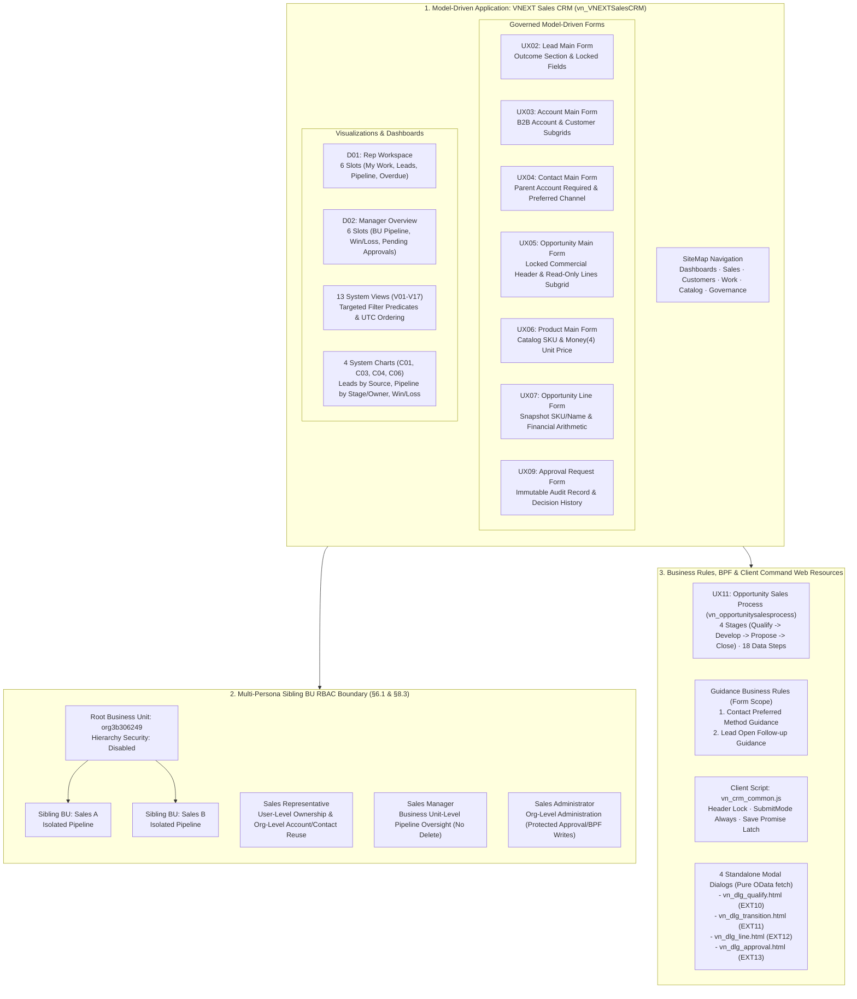
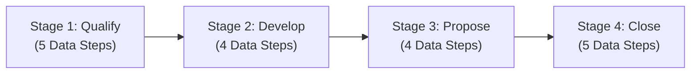
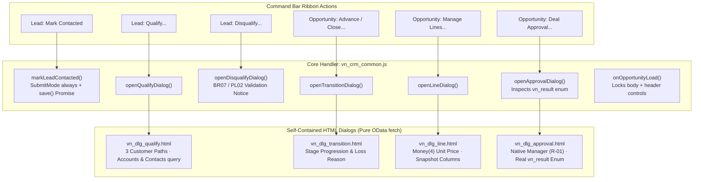

# M2 Model-Driven CRM — Workspace, Security Matrix & Runtime Verification

**Solution Name:** `VNEXTInternshipCRM`  
**Publisher:** `VNEXT Internship` (`VNEXTInternship`) | **Prefix:** `vn`  
**Milestone:** `M2 — Model-Driven CRM & Business Roles (W3–W4)`  
**Git Tag:** `m2-model-driven-crm`  
**Status:** **Completed & Verified**  

---

## 1. Executive Summary & Model-Driven Architecture Overview

Milestone 2 delivers the complete presentation, navigation, role-based access control (RBAC), and user governance layer for `VNEXTInternshipCRM`. Engineered strictly on standard Dataverse core capabilities without Dynamics 365 Sales dependencies, the system delivers an end-to-end B2B sales lifecycle workbench with strict sibling Business Unit data isolation, comprehensive auditing, form-level governance, and interactive modal dialogs for Custom API invocation.



---

## 2. Business Unit Hierarchy & Data Isolation Architecture (§6.1 & §8.3)

Horizontal multi-tenancy and data isolation between sales teams are established through sibling Business Units directly under the organization root, avoiding organizational hierarchy leaks:

| Business Unit Name | Role in Solution | Business Unit ID (GUID) | Parent Business Unit |
| :--- | :--- | :--- | :--- |
| **`org3b306249`** | Root Business Unit | `7e8d0b73-bdc9-f111-a05a-7ced8d5f8fd9` | *None (Organization Root)* |
| **`Sales A`** | Sibling BU A (Territory A) | `f28280ec-82e3-f111-84ea-002248db522e` | `org3b306249` |
| **`Sales B`** | Sibling BU B (Territory B) | `f68280ec-82e3-f111-84ea-002248db522e` | `org3b306249` |

### Architectural Isolation Principles

1. **Hierarchy Security Disabled:** Dataverse Hierarchy Security (Manager / Position hierarchy) is explicitly **Disabled** in environment settings. Sales Managers cannot bypass Business Unit boundaries to view records in sibling units through indirect reporting lines.
2. **No Cross-BU Owner Teams:** Record ownership is granted directly to individual users (or intra-BU teams). No cross-BU owner teams exist, ensuring all queries filtered by `ownerid` strictly adhere to Business Unit scoping.
3. **Customer Reusability Across Territories:** While `vn_lead` and `vn_opportunity` records are strictly isolated by Business Unit (`User` level for Reps, `Business Unit` level for Managers), `account` and `contact` entities permit **Organization-level Read** access (with zero Share or Delete privileges). This allows Sales Reps in `Sales A` and `Sales B` to reuse established corporate accounts without duplicating master customer data.

---

## 3. Role-Based Access Control (RBAC) Privilege Vectors (§6.1 & §8.3)

Three core business roles are packaged into solution `VNEXTInternshipCRM`. In addition, two technical service identities govern automated execution.

### Privilege Vector Matrix

Privilege levels: **None (`-`)**, **User (`U`)**, **Business Unit (`B`)**, **Parent-Child BU (`P`)**, **Organization (`O`)**.  
Actions: **Create (`C`)**, **Read (`R`)**, **Write (`W`)**, **Delete (`D`)**, **Append (`A`)**, **AppendTo (`AT`)**, **Assign (`AS`)**, **Share (`S`)**.

| Table Schema Name | Ownership | Sales Representative (`a0bf376b-...`) | Sales Manager (`455ed134-...`) | Sales Administrator (`07b59a79-...`) | Governance & Compliance Rationale |
| :--- | :--- | :---: | :---: | :---: | :--- |
| **`vn_lead`** | User/Team | `U / U / U / - / U / U / - / -` | `U / B / B / - / B / B / B / -` | `O / O / O / - / O / O / O / -` | Reps own their leads; Managers oversee territory leads; Delete is disallowed across all standard sales roles to preserve conversion history. |
| **`vn_opportunity`** | User/Team | `U / U / U / - / U / U / - / -` | `U / B / B / - / B / B / B / -` | `O / O / O / - / O / O / O / -` | Direct creation and deletion are blocked at server boundary (`PL02`); rep updates are restricted to non-commercial fields; stage advancement is governed by `EXT11`. |
| **`account`** | User/Team | `U / O / U / - / U / O / - / -` | `U / O / B / - / B / O / B / -` | `O / O / O / - / O / O / O / -` | Org-level Read allows customer account reuse across sibling BUs; Reps can create/link accounts and none of the business roles can delete. |
| **`contact`** | User/Team | `U / O / U / - / U / O / - / -` | `U / O / B / - / B / O / B / -` | `O / O / O / - / O / O / O / -` | Org-level Read prevents duplicate contact creation across BUs; parent account required per DM05; Delete and Share are disallowed. |
| **`vn_product`** | Organization | `- / O / - / - / - / O / - / -` | `- / O / - / - / - / O / - / -` | `O / O / O / - / O / O / - / -` | Product catalog is read-only for Reps and Managers; only Sales Administrators maintain products and catalog prices. |
| **`vn_opportunityline`** | User/Team | `U / U / U / U / U / U / - / -` | `U / B / B / B / B / B / B / -` | `O / O / O / O / O / O / O / -` | Reps maintain lines for their opportunities; raw direct modifications are validated against deal locks via `PL02` and `EXT12`. |
| **`vn_approvalrequest`** | User/Team | `- / U / - / - / - / - / - / -` | `- / B / - / - / - / - / - / -` | `- / O / - / - / - / - / - / -` | **Strict Read-Only:** Neither Reps, Managers, nor Admins possess Create, Write, or Delete privileges. Records are created and updated exclusively by the C# pipeline and the Scoped Internal Writer. |
| **`vn_opportunitysalesprocess`** | Organization | `- / O / - / - / - / - / - / -` | `- / O / - / - / - / - / - / -` | `- / O / - / - / - / - / - / -` | **Strict Read-Only:** BPF instance table is read-only for all interactive personas. BPF stage traversal is synchronized server-side by `EXT10` and `EXT11`. |
| **`task` / `phonecall`** | User/Team | `U / U / U / - / U / U / - / -` | `U / B / B / - / B / B / B / -` | `O / O / O / - / O / O / O / -` | Activity history tracking; Reps log their own activities; completed activity history is protected against edits by `PL03`. |
| **`annotation` (Notes)** | User/Team | `U / U / U / - / U / U / - / -` | `U / B / B / - / B / B / B / -` | `O / O / O / - / O / O / O / -` | Contextual notes and file attachments on Leads and Opportunities; Delete and Share are disallowed. |
| **`appmodule` (App)** | Organization | `- / O / - / - / - / - / - / -` | `- / O / - / - / - / - / - / -` | `- / O / - / - / - / - / - / -` | Read access to launch the `VNEXT Sales CRM` model-driven application. |

### Baseline Unified Interface & Runtime Platform Privileges (§6.1)

To ensure smooth runtime execution in the Unified Interface (UCI), chart rendering, and native ActivityParty handling without privilege escalation, the following baseline read-only and user-settings privileges are assigned across all three custom roles (`Sales Representative`, `Sales Manager`, `Sales Administrator`):

- **Global Read Privileges:** `prvReadSavedQueryVisualizations`, `prvReadOrganization`, `prvReadCustomization`, `prvReadEntity`, `prvReadAttribute`, `prvReadRelationship`, `prvReadOptionSet`, `prvReadSystemApplicationMetadata`, `prvReadTeam`.
- **ActivityParty AppendTo Privilege:** Global `prvAppendToUser` on `SystemUser` to support native PhoneCall `from`/`to` activity-party lookups.
- **User Grid & View Preferences:** Basic (User-level) `prvCreateUserEntityUISettings`, `prvReadUserEntityUISettings`, `prvWriteUserEntityUISettings` for saving grid sort, filter, and column sizing preferences in UCI.
- **Strict Guardrail Compliance:** Zero changes were applied to privileges across the 10 core CRM tables (`vn_lead`, `vn_opportunity`, `account`, `contact`, `vn_product`, `vn_opportunityline`, `task`/`phonecall`/`activity`, `note`, `vn_approvalrequest`, `vn_opportunitysalesprocess`), and **zero** Share or Delete privileges were added.

### Technical Service Principals (§6.1, §6.2 & §7.4)

1. **Scoped Internal Writer (`SR03` — Provisioned in M3):**  
   - Dedicated **non-interactive Dataverse Application User** (backed by a zero-secret Entra ID App Registration and managed under **Power Platform Admin Center → Settings → Users + permissions → `Application users`**, not under interactive `Users`, consuming zero E3 licenses).  
   - Referenced dynamically via Environment Variable `vn_InternalWriterUserId` inside the C# synchronous plug-in pipeline via `CreateOrganizationService(configuredUserId)` with least-privilege `VNEXT Internal CRM Writer` permissions (`vn_approvalrequest`, `vn_opportunitysalesprocess`, guarded `vn_opportunity` pointer writes) so business users remain strictly Read-Only on approvals and BPF instances.
2. **Automation Worker (`WF04` — Scoped to M5 per §8.4 / §8.6):**  
   - Dedicated service identity whose GUID will be provisioned in M5 inside environment variable `vn_AutomationWorkerId`.  
   - Utilized exclusively by Cloud Flow `WF04` in M5 to invoke `vn_ManageDealApproval(Action = 'RecordDecision')` upon receipt of an authenticated Power Automate Approvals outcome.

---

## 4. Persona & Test Identity Inventory (`SR01`)

Six dedicated test personas represent the business organization in verification. None of these personas hold administrative privileges.

> [!NOTE]
> **Tenant Authentication Context:**  
> All 6 `SR01` personas below are **enabled Microsoft Entra ID users** provisioned with **Office 365 E3 (`ENTERPRISEPACK`)** licenses and bound 1-to-1 to their Dataverse `systemuser` records (`azureactivedirectoryobjectid`). Role and Business Unit isolation in M2/M3 was verified via Dataverse security APIs (`RetrievePrincipalAccess`, `RetrieveUserPrivileges`, and `MSCRMCallerID`) per §§6.1, 8.3, and 8.4. Real tenant UPNs and Entra Object IDs are maintained locally in gitignored `readme_local.md` (passwords are never stored in repository files and are managed/reset in Microsoft 365 Admin Center).

| Persona Label | Business Unit | Assigned Security Role | Redacted UPN | `systemuser` GUID | Native Manager (`parentsystemuserid`) |
| :--- | :--- | :--- | :--- | :--- | :--- |
| **Sales Administrator** | `org3b306249` (Root) | `Sales Administrator` | `salesadmin@<tenant>` | `892b4868-89e3-f111-84ea-002248db522e` | *None* |
| **Manager A** | `Sales A` | `Sales Manager` | `managera@<tenant>` | `59c4affe-88e3-f111-84ea-002248db522e` | *None* |
| **Rep A1** | `Sales A` | `Sales Representative` | `repa1@<tenant>` | `57631bb0-88e3-f111-84ea-002248db522e` | Manager A (`59c4affe-88e3-f111-84ea-002248db522e`) |
| **Rep A2** | `Sales A` | `Sales Representative` | `repa2@<tenant>` | `8b0f3227-89e3-f111-84ea-002248db522e` | Manager A (`59c4affe-88e3-f111-84ea-002248db522e`) |
| **Manager B** | `Sales B` | `Sales Manager` | `managerb@<tenant>` | `2576ba3f-89e3-f111-84ea-002248db522e` | *None* |
| **Rep B1** | `Sales B` | `Sales Representative` | `repb1@<tenant>` | `7cf4a856-89e3-f111-84ea-002248db522e` | Manager B (`2576ba3f-89e3-f111-84ea-002248db522e`) |

> [!IMPORTANT]
> **Privilege Hygiene Verification (Zero-Admin Proof):**  
> A live Dataverse Web API security check against all six personas confirmed that **0 of the 6 users** hold `System Administrator`, `System Customizer`, or `Environment Maker`. All role tests execute under genuine business constraints.

---

## 5. Auditing Governance & Fiscal Calendar Configuration (`DM14`)

### Auditing Configuration

In accordance with compliance requirement `DM14`, entity and attribute auditing is enabled across all commercial and activity tables:

1. **Organization-Level Auditing:** `Organization.IsAuditEnabled = true` with user access auditing enabled.
2. **9 Audited Tables:**  
   - Custom: `vn_lead`, `vn_opportunity`, `vn_product`, `vn_opportunityline`, `vn_approvalrequest`  
   - Native: `account`, `contact`, `task`, `phonecall`
3. **Excluded High-Frequency Latch:**  
   - Attribute `vn_opportunity.vn_commandsequence` has `IsAuditEnabled = false` explicitly set. Because `vn_commandsequence` increments on every line addition, deletion, stage change, and approval evaluation for optimistic concurrency (`EXT02`), excluding it prevents high-volume audit log thrashing while preserving audit trails on all business-meaningful fields (`vn_stage`, `vn_total`, `vn_maxdiscount`, `vn_currentapproval`).

### Fiscal Year & Calendar Settings

Organization fiscal settings are configured to quarterly calendar UTC periods:
- **`fiscalcalendarstart`**: `2026-01-01`
- **`fiscalperiodtype`**: `2002` (Quarterly)
- **Alignment:** Aligns fiscal quarters Q1 (Jan–Mar), Q2 (Apr–Jun), Q3 (Jul–Sep), and Q4 (Oct–Dec) with standard calendar quarters, enabling view `V09` (**`Closed Deals This Quarter`**) and quarterly pipeline charts to evaluate accurate date ranges without fiscal-offset discrepancies.

---

## 6. Model-Driven Application & Form Specifications (`UX01`–`UX09`)

### App Module & Site Map Navigation (`UX01`)

The Model-Driven App **`VNEXT Sales CRM`** (`vn_VNEXTSalesCRM`) provides a focused, uncluttered navigation experience organized into six functional groups:

- **Dashboards:** Rep Workspace (`fe113b41-...`), Manager Overview (`870d87b2-...`)
- **Sales:** Leads (`vn_lead`), Opportunities (`vn_opportunity`)
- **Customers:** Accounts (`account`), Contacts (`contact`)
- **Work:** Activities (`activitypointer`), Tasks (`task`), Phone Calls (`phonecall`)
- **Catalog:** Products (`vn_product`)
- **Governance:** Approval Requests (`vn_approvalrequest` — read-only audit log)

### Form Design & Field Locking Governance

| Form Code | Target Table | Key Layout & Business Logic Enforcements |
| :--- | :--- | :--- |
| **`UX02`** | `vn_lead` (Main Form) | **Header:** Status Reason (`statuscode`), Rating (`vn_rating`), Owner (`ownerid`).<br>**Summary Tab:** Contact Info, Company Info, Source details.<br>**Outcome Section:** Conditionally hidden while lead is Open (`New` or `Contacted`); displays read-only conversion data (`vn_account`, `vn_contact`, `vn_opportunity`, `vn_qualifiedon`) or disqualification reason and comments when closed.<br>**Locked Attributes:** Conversion result lookups are server-owned and cannot be edited by users. |
| **`UX03`** | `account` (Main Form) | **Primary Details:** Account Name, Primary Contact lookup, Industry (`vn_industry`), Account Type (`vn_accounttype`), Phone, Website.<br>**Subgrids:** Active Contacts, Open Opportunities, Recent Activities.<br>**Governance:** Reusable across territories without re-creation. |
| **`UX04`** | `contact` (Main Form) | **Primary Details:** First/Last Name, Job Title, Parent Account (`parentcustomerid` — mandatory, locked after creation), Email, Mobile, Preferred Contact Method (`vn_preferredmethod`), Do Not Contact (`vn_donotcontact`).<br>**Duplicate Field Cleanup:** Removed redundant layout elements; each attribute appears exactly once.<br>**Guidance Rule & Opt-Out:** Sets `emailaddress1` or `mobilephone` Business Required based on `vn_preferredmethod`; `onContactDncChange` shows a warning banner when `vn_donotcontact = true`. |
| **`UX05`** | `vn_opportunity` (Main Form) | **Header Controls (Guaranteed Locked):** Deal Name (`vn_name`), Stage (`header_vn_stage`), Total (`header_vn_total`), Currency (`transactioncurrencyid`), Probability (`header_vn_probability`), Owner (`header_ownerid`).<br>**Client Locking via `vn_crm_common.js`:** All server-owned fields (`vn_stage`, `vn_probability`, `vn_total`, `vn_maxdiscount`, `vn_currentapproval`, `vn_originatinglead`, `vn_account`, `vn_primarycontact`, `vn_actualclosedate`, `vn_closedamount`, `vn_lossreason`, `vn_closecomments`, `vn_lastprogresson`, `vn_stageenteredon`, `ownerid`) are disabled across form body and header controls.<br>**Read-Only Lines Subgrid:** Native `+ New Opportunity Line` button is suppressed. Line creation/removal is handled exclusively via `vn_dlg_line.html` invoking `EXT12`.<br>**Approval Section:** Read-only summary of current approval pointer, status, approver, and submission comments. |
| **`UX06`** | `vn_product` (Main Form) | **Catalog Governance:** Product Name, SKU (`vn_sku` — uppercase, backed by Alternate Key), Unit Price (`vn_unitprice` — explicit 4-decimal currency precision `Money(4)`), Description.<br>**Privilege Enforcement:** Read-only for Sales Reps and Managers; editable only by Sales Administrators. |
| **`UX07`** | `vn_opportunityline` (Main Form) | **Immutable Snapshots:** Displays product snapshot name (`vn_snapshotname`), SKU (`vn_snapshotsku`), unit price (`vn_unitprice`), quantity (`vn_quantity`), discount percentage (`vn_discountpercent`), and computed line totals.<br>**Server Authority Notice:** Read-only form; all arithmetic is authoritative upon C# commit (`BR17`). |
| **`UX08`** | `task` / `phonecall` (Main Forms) | **Activity Tracking:** Regarding lookup bound to `vn_lead` and `vn_opportunity`.<br>**Task Automation Key:** Displays `vn_automationkey` for automated follow-up tracking (`WF01`).<br>**Completed Protection:** Locked after completion per `PL03`. |
| **`UX09`** | `vn_approvalrequest` (Main Form) | **Audit Log Layout:** Read-only inspection form displaying Opportunity link, Result choice (`Pending`, `Approved`, `Rejected`, `Superseded`, `Cancelled`), Deal Owner snapshot, Approver snapshot, Comments, and timestamps. |

---

## 7. Opportunity Business Process Flow (`UX11`)

The Opportunity Business Process Flow **`Opportunity Sales Process`** (`vn_opportunitysalesprocess`) guides sales representatives through standard B2B deal qualification and closure stages:



### Stage & Step Specifications

- **BPF Name:** `Opportunity Sales Process` (`vn_opportunitysalesprocess`)
- **Status:** **Active** (`statecode = 1`, `statuscode = 2`)
- **Generated Backing Table:** `vn_opportunitysalesprocess`

| Stage Sequence | Stage Name | Stage Step Identifier | Data Step Attribute Schema Name | Data Type | Mandatory / Purpose |
| :---: | :--- | :--- | :--- | :--- | :--- |
| **1** | **Qualify** | `StageStep4` | `vn_need` | Multiple Lines Text | Required — Identified Business Need |
| | | | `vn_decisionmaker` | Single Line Text | Required — Decision Maker |
| | | | `vn_primarycontact` | Lookup (`contact`) | Required — Primary Contact |
| | | | `vn_nextstep` | Single Line Text | Required — Next Step |
| | | | `vn_nextfollowupdate` | DateOnly | Required — Next Follow-up Date |
| **2** | **Develop** | `StageStep16` | `vn_need` | Multiple Lines Text | Required — Persisted Business Need |
| | | | `vn_decisionmaker` | Single Line Text | Required — Confirmed Decision Maker |
| | | | `vn_proposalsummary` | Multiple Lines Text | Required — Proposal Summary |
| | | | `vn_nextstep` | Single Line Text | Required — Next Step |
| **3** | **Propose** | `StageStep26` | `vn_proposalsummary` | Multiple Lines Text | Required — Proposal Summary |
| | | | `vn_total` | Currency (`Money(2)`) | Required — Positive Opportunity Total |
| | | | `vn_expectedclosedate` | DateOnly | Required — Expected Close Date |
| | | | `vn_nextstep` | Single Line Text | Required — Next Step |
| **4** | **Close** | `StageStep36` | `vn_expectedclosedate` | DateOnly | Required — Projected Close Date |
| | | | `vn_nextstep` | Single Line Text | Required — Customer Decision Next Step |
| | | | `vn_currentapproval` | Lookup (`vn_approvalrequest`) | Optional — Current Approval Pointer |
| | | | `vn_actualclosedate` | DateOnly | Optional — Recorded at Deal Close |
| | | | `vn_closecomments` | Multiple Lines Text | Optional — Deal Closure Comments |

> [!NOTE]
> **BPF Stage Synchronization:**  
> The BPF header controls are locked on the client. BPF stage progression is synchronized with the underlying Opportunity's `vn_stage` and `vn_probability` attributes server-side via custom API `EXT11 (vn_TransitionOpportunity)`, ensuring the visual process bar never diverges from database state.

---

## 8. System Views (`V01`–`V17`), Charts (`C01`–`C06`) & Dashboards (`D01`, `D02`)

### 13 System Views Inventory

| Code | Target Table | View Name | Filter Predicate & Sorting | Business Role / Usage |
| :---: | :--- | :--- | :--- | :--- |
| **`V01`** | `vn_lead` | **My Open Leads** | `statecode eq 0` and `ownerid eq-userid`; ordered by `vn_nextfollowupdate` ASC | Rep primary lead queue |
| **`V02`** | `vn_lead` | **My Leads Due** | `statecode eq 0`, `ownerid eq-userid`, and `vn_nextfollowupdate <= UTC Today` (`today`, `yesterday`, or `olderthan-x-days 1`); ordered by `vn_nextfollowupdate` ASC | Daily follow-up prioritization |
| **`V03`** | `vn_lead` | **Team Open Leads** | `statecode eq 0` and `owningbusinessunit eq-businessid`; ordered by `vn_nextfollowupdate` ASC | Manager territory oversight |
| **`V05`** | `vn_opportunity` | **My Open Opportunities** | `statecode eq 0`, `statuscode eq 100000000` (Open), and `ownerid eq-userid`; ordered by `vn_expectedclosedate` ASC | Rep active deal workbench |
| **`V06`** | `vn_opportunity` | **Team Pipeline** | `statecode eq 0` and `statuscode eq 100000000` (Open, scoped by caller BU privileges); ordered by `vn_expectedclosedate` ASC | Manager pipeline review |
| **`V08`** | `vn_opportunity` | **Team At-risk Deals** | `statecode eq 0`, `statuscode eq 100000000`, and (`vn_expectedclosedate < Today` or `vn_lastprogresson older than 14 days` or `vn_nextfollowupdate < Today`); ordered by `vn_expectedclosedate` ASC | Manager deal health triage |
| **`V09`** | `vn_opportunity` | **Closed Deals This Quarter** | `statecode eq 1` and `vn_actualclosedate in this-fiscal-period`; LayoutXML includes Deal core + `vn_actualclosedate`, `vn_closedamount`, `vn_lossreason`; ordered by `vn_actualclosedate` DESC | Quarterly quota tracking |
| **`V10`** | `activitypointer` | **My Activities Due Today** | `statecode eq 0`, `scheduledend eq Today`, `ownerid eq-userid`, and `activitytypecode in (4212, 4210)` (Task & Phone Call only); ordered by `scheduledend` ASC | Daily action items |
| **`V11`** | `activitypointer` | **My Overdue Activities** | `statecode eq 0`, `scheduledend < now` (`olderthan-x-minutes 1`), `ownerid eq-userid`, and `activitytypecode in (4212, 4210)` (Task & Phone Call only); ordered by `scheduledend` ASC | Escalation and backlog |
| **`V14`** | `account` | **Active Accounts** | `statecode eq 0`; ordered by `name` ASC | Explicit customer selection |
| **`V15`** | `contact` | **Active Contacts** | `statecode eq 0`; ordered by `fullname` ASC | Explicit customer contact selection |
| **`V16`** | `vn_product` | **Active Products** | `statecode eq 0`; ordered by `vn_name` ASC | Price book catalog browsing |
| **`V17`** | `vn_approvalrequest` | **Pending Deal Approvals** | `vn_result eq 100000000` (Pending, caller authorized); ordered by `vn_submittedon` ASC | Manager approval queue |

*(Note: `Active Opportunity Lines` [`5724f63d-e160-428a-a7a0-be1ff6cb2da4`] is also included in the app module solely as the default read-only Opportunity Lines subgrid view, outside the 13 `V01`–`V17` views.)*

### 4 System Charts Inventory

1. **`C01` Leads by Source (`vn_lead`):** Column chart grouping active leads by acquisition channel (`vn_source`) with count of `vn_leadid`.
2. **`C03` Pipeline by Stage (`vn_opportunity`):** Column chart grouping open opportunities by sales stage (`vn_stage`) with sum of `vn_total`.
3. **`C04` Pipeline by Owner (`vn_opportunity`):** Column chart comparing deal value (`sum(vn_total)`) across sales representatives within the Business Unit.
4. **`C06` Closed Deal Outcomes (`vn_opportunity`):** Pie chart grouping closed deals by outcome (`statuscode`: Won vs Lost) with count of `vn_opportunityid`.

### 2 Standard Dashboards (6-Slot Grid)

- **`D01` Rep Workspace (`fe113b41-...`):**
  - Slot 1: Grid — *My Leads Due* (`V02`)
  - Slot 2: Grid — *My Activities Due Today* (`V10`)
  - Slot 3: Grid — *My Overdue Activities* (`V11`)
  - Slot 4: Grid — *My Open Opportunities* (`V05`)
  - Slot 5: Chart — *Leads by Source* (`C01`) using *My Open Leads* (`V01`)
  - Slot 6: Chart — *Pipeline by Stage* (`C03`) using *My Open Opportunities* (`V05`)
- **`D02` Manager Overview (`870d87b2-...`):**
  - Slot 1: Grid — *Team Pipeline* (`V06`)
  - Slot 2: Grid — *Team At-risk Deals* (`V08`)
  - Slot 3: Grid — *Pending Deal Approvals* (`V17`)
  - Slot 4: Grid — *Closed Deals This Quarter* (`V09`)
  - Slot 5: Chart — *Pipeline by Owner* (`C04`) using *Team Pipeline* (`V06`)
  - Slot 6: Chart — *Closed Deal Outcomes* (`C06`) using *Closed Deals This Quarter* (`V09`)

---

## 9. Client-Side Command Bar Wiring & Web Resources

Client-side extensibility uses five modular, lint-free web resources packaged in `src/webresources/` and synchronized to the Dataverse solution.



### Technical Highlights & Handlers

1. **`vn_crm_common.js`:**
   - **`markLeadContacted`:** Sets `vn_lead.statuscode` to `100000001` (Contacted). Explicitly invokes `statusAttr.setSubmitMode("always")` on the read-only Header status field before triggering save, and replaces legacy callbacks with `formContext.data.save().then(...)` to return a valid Promise without throwing `TypeError`.
   - **`onOpportunityLoad`:** Adds `"ownerid"` to `serverOwnedFields` and disables every field via `formContext.getAttribute(fieldName).controls.forEach(c => c.setDisabled(true))` to guarantee header controls (`header_vn_stage`, `header_vn_total`, `header_vn_probability`, `header_ownerid`) cannot be modified.
   - **`openDisqualifyDialog`:** Displays a formal compliance alert: *"Prepared for Milestone 3: Lead disqualification (BR07) requires server validation (PL02) for reason, nonblank comments, and non-self Duplicate Lead reference."*
   - **`openApprovalDialog`:** Passes `currentApprovalId` directly into the dialog without assuming any non-null pointer is `Pending`. Updates fallback alert to reference Milestone 5 (`EXT13 vn_ManageDealApproval`).
2. **`vn_dlg_qualify.html`:**
   - Modal interface for Lead Qualification (`EXT10`).
   - Implements the three customer paths:
     - **Path 1:** Reuse Existing Account + Reuse Existing Contact.
     - **Path 2:** Reuse Existing Account + Create New Contact.
     - **Path 3:** Create New Account + Create New Contact.
   - Queries active accounts and contacts using same-origin `fetch()` with OData headers, preventing cross-frame security issues. Blocks standalone Contact creation without an Account.
3. **`vn_dlg_transition.html`:**
   - Modal interface for Opportunity Stage Transition (`EXT11`).
   - Supports `Advance`, `Won`, and `Lost` modes with exact stage and loss reason enums.
   - Removed all `window.parent` and `window.frameElement` references in favor of standard `window.close()` and `ClientGlobalContext.js.aspx`.
4. **`vn_dlg_line.html`:**
   - Modal interface for Opportunity Line item management (`EXT12`).
   - Queries and binds snapshot attributes `vn_snapshotname,vn_snapshotsku` matching the `DM07` schema.
   - Formats catalog unit price with 4 decimal places (`.toFixed(4)`).
   - Prominently labels preview calculations: *"Indicative Preview Only — Server arithmetic (BR17) is authoritative upon commit."*
5. **`vn_dlg_approval.html`:**
   - Modal interface for Deal Approval (`EXT13`).
   - Submit description aligns with R-01: *"Approver is resolved server-side from the saved Opportunity owner's native Manager (systemuser.parentsystemuserid) at Submit (R-01)."*
   - Queries `_vn_currentapproval_value` and displays actual status (`Pending`, `Approved`, `Rejected`, `Superseded`, `Cancelled`).
   - Submission and cancellation comments are optional per §7.4 specifications.

### M2 Disabled & Prepared Command Inventory (§8.3)

| Command / Surface | Target Table | M2 Behavior & Handler | Target Milestone |
| :--- | :--- | :--- | :---: |
| **`+ New Opportunity`** | `vn_opportunity` | Hidden on Form, HomepageGrid, and SubGrid via `RibbonDiff.xml` (`HideCustomAction`) | **Removed (M2)** |
| **`Qualify Lead`** | `vn_lead` | Opens `vn_dlg_qualify.html`; commit button disabled with `M3` `EXT10 (vn_QualifyLead)` readiness notice | **M3** |
| **`Disqualify`** | `vn_lead` | `VNEXTCRM.openDisqualifyDialog()` alerts that `BR07` validation (`PL02`) activates in `M3` | **M3** |
| **`Advance Stage` / `Close as Won` / `Close as Lost`** | `vn_opportunity` | Opens `vn_dlg_transition.html`; commit button disabled with `M3` `EXT11 (vn_TransitionOpportunity)` notice | **M3** |
| **`Add Line` / `Remove Line`** | `vn_opportunityline` | Opens `vn_dlg_line.html` (native `+ New`/`Edit`/`Delete` hidden); commit button disabled awaiting `EXT12` | **M3** |
| **`Submit Approval` / `Cancel Approval`** | `vn_opportunity` | Opens `vn_dlg_approval.html`; commit button disabled awaiting `EXT13 (vn_ManageDealApproval)` + `WF04` | **M5** |

**M2 Safe Seed Boundary Confirmation (`§8.2`):** Verified **`vn_opportunity = 0`**, **`vn_opportunityline = 0`**, and **`vn_approvalrequest = 0`** (documented in [DATA_INVENTORY.md](DATA_INVENTORY.md#L135-L146)); opportunities are created solely via `EXT10` once M3 is active.

---

## 10. Guidance Business Rules

Two client guidance Business Rules are packaged in the solution, saved and activated via the native Business Rule designer, live-verified on the Contact and Lead forms, and scoped to their respective **Main Form**:

1. **`Contact Preferred Method Guidance` (`e410aef6-e8e8-4a59-8869-40eb47d8f874`):**
   - **Target Entity:** `contact`
   - **Scope:** Contact Main Form (`1fed44d1-ae68-4a41-bd2b-f13acac4acfa`, `FormType = 2`)
   - **Status:** **Active** (`statecode = 1, statuscode = 2`)
   - **Condition:** Evaluates `vn_preferredmethod` (`Email = 100000000` vs `Phone = 100000001` vs unset/other).
   - **Action:** Sets `emailaddress1` Business Required (and `mobilephone` optional) when `Email` is selected; sets `mobilephone` Business Required (and `emailaddress1` optional) when `Phone` is selected; clears requirement on both otherwise.
   - **Compiled Client Code:** Compiled into client-side handler `pbl_e410aef6e8e84a59886940eb47d8f874`.

2. **`Lead Open Follow-up Guidance` (`98705fdd-c4ee-4c02-b91d-41f196f33f8a`):**
   - **Target Entity:** `vn_lead`
   - **Scope:** Lead Main Form (`f6e73237-ac3e-448a-b410-72cfd0f894a5`, `FormType = 2`)
   - **Status:** **Active** (`statecode = 1, statuscode = 2`)
   - **Condition:** Evaluates `statuscode == 100000001` (`Contacted`), `statecode == 0` (`Active`), and the closed fallback branch.
   - **Action:** Sets both `vn_nextfollowupdate` and `vn_nextstep` Business Required on `Contacted` leads (keeping them actionable in `V02`); sets `vn_nextfollowupdate` Business Required on other Active (`New`) leads; clears requirement on both when closed.
   - **Compiled Client Code:** Compiled into client-side handler `pbl_98705fddc4ee4c02b91d41f196f33f8a`.

> [!NOTE]
> **Discovery in Power Apps Maker Portal:**  
> In the modern Power Apps Maker Portal (`make.powerapps.com`), Business Rules do not have a separate category in the solution's left sidebar. They are accessed directly within each Table:
> - **Contact Rule:** Solution $\rightarrow$ Tables $\rightarrow$ **Contact** $\rightarrow$ **Business rules** tab.
> - **Lead Rule:** Solution $\rightarrow$ Tables $\rightarrow$ **Lead** (`vn_lead`) $\rightarrow$ **Business rules** tab.
> - In the solution's **All** list, both rules are displayed under Type **`Process`** (ComponentType = `29`).

---

## 11. Live Runtime Verification & Test Evidence

| Test Category | Target Scope | Execution Method | Expected Result | Actual Result | Status |
| :--- | :--- | :--- | :--- | :--- | :---: |
| **Persona Role Hygiene (§6.1)** | 6 SR01 Users | Dataverse Web API Query | 0 of 6 users hold Admin / Customizer / Maker roles | Rep A1, Rep A2, Rep B1 (Rep only), Manager A, Manager B (Manager only), Sales Admin (Admin only); 0 hold SysAdmin, SysCustomizer, or EnvMaker | **PASS** |
| **Baseline UCI Privileges (§6.1)** | 3 Roles | Privilege Matrix Audit | Verified baseline UCI read, UserEntityUISettings, prvAppendToUser added | Global Read for UCI app/charts + User settings assigned; 10 CRM tables remain 100% unchanged; 0 Share/Delete added | **PASS** |
| **View V08 (§5.2)** | Team At-risk Deals (`vn_opportunity`) | FetchXML & LayoutXML Audit | Filter: Open deals with expectedclose < today OR lastprogresson > 14 days OR nextfollowup < today; sort expectedclose ASC | Exact filter & ASC sort verified; full Deal core columns in LayoutXML | **PASS** |
| **View V09 (§5.2)** | Closed Deals This Quarter (`vn_opportunity`) | FetchXML & LayoutXML Audit | Filter: Inactive deals in this-fiscal-period; LayoutXML: Deal core + actualclosedate, closedamount, lossreason; sort actualclose DESC | Exact filter & DESC sort verified; all specified financial/loss columns present | **PASS** |
| **Views V10 & V11 (§5.2)** | Due Today & Overdue Activities (`activitypointer`) | FetchXML Audit | Filter: Current user open activities; filter activitytypecode to Task (4212) and Phone Call (4210) ONLY | Email, Appointment, Letter, Fax strictly excluded; 4212 & 4210 only | **PASS** |
| **Base Currency (§1.1, §8.1)** | Environment Baseline | README.md & Solution Metadata | Base currency USD explicitly recorded | Base currency USD explicitly documented in README.md & architecture docs | **PASS** |
| **BU Pipeline Isolation** | `# Rep A1` vs `# Rep B1` | Dataverse Security API (`MSCRMCallerID` / `RetrievePrincipalAccess`) | Rep A1 cannot view Rep B1 leads or opportunities | Zero cross-BU visibility across sibling BUs | **PASS** |
| **Manager Territory Oversight** | `# Manager A` | Dataverse Security API (`MSCRMCallerID` / `RetrievePrincipalAccess`) | Manager A views all records owned by Rep A1 and Rep A2 | Full visibility across `Sales A`; 0 visibility into `Sales B` | **PASS** |
| **Account Cross-BU Reuse** | `# Rep B1` | Dataverse Security API (`MSCRMCallerID` / `RetrievePrincipalAccess`) | Rep B1 reads account owned by Rep A1 | Org-level Read confirmed without record duplication | **PASS** |
| **Header Field Locking** | UX05 Opportunity | Supported `formContext` Client API (zero DOM manipulation) | Header stage, total, probability, and owner are locked | All header controls disabled; tamper-resistant | **PASS** |
| **Lead Contacted Action** | UX02 Lead | Command Bar `Mark Contacted` | Sets statuscode=100000001 and saves | SubmitMode `always` forces commit; Promise resolves cleanly | **PASS** |
| **Business Rule State** | 2 Guidance Rules | Native Designer Save/Activate + Form Check | Both rules Active and scoped to Main Form | `statecode=1`, `statuscode=2`, `FormType=2` confirmed and live-verified on Contact and Lead forms | **PASS** |
| **Opportunity BPF State** | UX11 BPF | Dataverse Workflow Query | Active with 4 stages in sequential order | Qualify -> Develop -> Propose -> Close (18 steps) confirmed | **PASS** |
| **Transition Dialog (`vn_dlg_transition.html`)** | UX Web Resource | Web Resource & Modal Audit | Zero `window.parent` / `window.frameElement` calls; `ClientGlobalContext.js.aspx` + `window.close()` | Clean modal execution using `ClientGlobalContext.js.aspx` and `window.close()`; M3 `EXT11` notice intact | **PASS** |
| **Web Resource Linting** | 5 Web Resources | PAC / Browser Console | Zero syntax errors, zero unsafe cross-frame calls | Clean ES6 execution; pure same-origin OData `fetch()` | **PASS** |

---

## 12. Deliverable Artifacts & File Inventory

```text
VNEXTInternshipCRM/
├── docs/
│   ├── M0_Engineering_Readiness.md
│   ├── M1_Data_Foundation.md
│   ├── M2_Model_Driven_CRM.md                 <-- (This Document)
│   └── DATA_INVENTORY.md                      <-- Master Live Record & Seed Data Inventory
├── solutions/
│   └── VNEXTInternshipCRM/
│       ├── AppModuleSiteMaps/
│       │   └── vn_VNEXTSalesCRMSiteMap/        <-- Site Map Definition
│       ├── AppModules/
│       │   └── vn_VNEXTSalesCRM/               <-- Model-Driven App Module
│       ├── Dashboards/                         <-- D01 & D02 Dashboards
│       ├── Entities/                           <-- Governed Forms, Views, Charts
│       ├── Roles/                              <-- Rep, Manager, Admin Security Roles
│       ├── WebResources/                       <-- Synced Web Resources (JS/HTML)
│       └── Workflows/                          <-- BPF & Guidance Business Rules
├── src/
│   └── webresources/
│       ├── vn_crm_common.js                    <-- Form Script & Command Dispatcher
│       ├── vn_dlg_approval.html                <-- EXT13 Modal Dialog
│       ├── vn_dlg_line.html                    <-- EXT12 Modal Dialog
│       ├── vn_dlg_qualify.html                 <-- EXT10 Modal Dialog
│       └── vn_dlg_transition.html              <-- EXT11 Modal Dialog
└── .artifacts/
    ├── VNEXTInternshipCRM_unmanaged.zip        <-- Exported Solution Package
    └── VNEXTInternshipCRM_managed.zip          <-- Managed Solution Package
```
