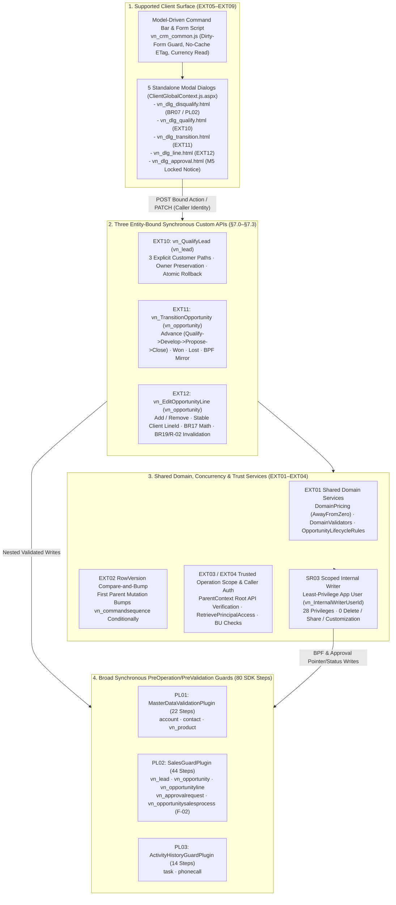

# M3 Transactional CRM & Server-Side Engineering — Architecture, API Contracts & Verification

**Solution Name:** `VNEXTInternshipCRM`  
**Publisher:** `VNEXT Internship` (`VNEXTInternship`) | **Prefix:** `vn`  
**Milestone:** `M3 — C# Transactional CRM & Server-Side Engineering (W5–W6)`  
**Target Git Tag:** `m3-transactional-crm`  
**Status:** **Completed & Verified**

---

## 1. Executive Summary & Single Server Trust Boundary

Milestone 3 establishes the authoritative **Single Server Trust Boundary** (`§6`–`§7`) for `VNEXTInternshipCRM`. All lead conversions, stage transitions, deal closures, priced product line items, concurrency coordination, master-data integrity checks, and activity-history protections are enforced synchronously inside atomic Dataverse database transactions by a signed `.NET Framework 4.6.2` plug-in assembly (`VNEXT.CRM.Plugins.dll`).



### Strict M3 / M5 Scope Boundary (§8.4)
- **Delivered in M3:** `EXT10`, `EXT11`, `EXT12`, `PL01`–`PL03` (80 steps), `EXT01`–`EXT04`, `SR03` Scoped Internal Writer, `BR20` approval threshold checks (`Total >= $50,000` OR `MaxDiscount > 10.00%`), `BR19`/`R-02` atomic approval-pointer invalidation on real Line Add/Remove, refusal of approval-triggered `Won` without a genuine current `Approved` request (`[CRM012]`), and supported UI dialogs wired to live M3 APIs.
- **Locked Out Until M5:** `EXT13` (`vn_ManageDealApproval`) is **not** created in M3 (`0` records in `customapis`), `vn_AutomationWorkerId` is not provisioned yet, `vn_approvalrequest` contains **`0` records**, and `vn_dlg_approval.html` remains strictly disabled with explicit M5 (`EXT13` / `WF04`) prerequisite messaging.

---

## 2. Signed Plug-in Assembly & C# Project Architecture

### 2.1 Assembly Deployment Metadata

| Property | Verified Live Value |
| :--- | :--- |
| **Assembly Name** | `VNEXT.CRM.Plugins` |
| **Target Framework** | `.NET Framework 4.6.2` (`net462`, strong-name signed; `.snk` gitignored) |
| **Version / Culture / PublicKeyToken** | `1.0.0.0` · `neutral` · `d0a6c558d4ce78b7` |
| **Isolation Mode / Source Type** | `Sandbox` (`2`) · Database (`0`) |
| **Dataverse `pluginassemblyid`** | `850f5f8e-44e7-f111-84ea-002248db522e` |
| **Deployed Release Binary** | `138,240` bytes · `@odata.etag = W/"2821898"` · `modifiedon = 2026-11-24T14:15:11Z` |
| **Release Build Status** | `dotnet build src/plugins/VNEXT.CRM.Plugins.sln -c Release` → **`0 Warning(s)`, `0 Error(s)`** |
| **Automated Unit Test Suite** | `dotnet test -c Release --no-build` → **`103 / 103` Passed (`0` Failed, `0` Skipped)** |

### 2.2 Six Registered Plug-in Types & Modular Codebase

| Layer | C# Source Files (`src/plugins/VNEXT.CRM.Plugins/`) | Responsibility |
| :--- | :--- | :--- |
| **Core** | `Core/CrmSchema.cs`, `Core/CrmError.cs`, `Core/CrmPolicyConfig.cs`, `Core/UtcClock.cs`, `Core/PluginAssemblyInfo.cs` | Single source of schema constants, exact 20-code `CRM001`–`CRM022` error catalog with `CorrelationId`, dynamic environment variable & base currency loading, pure UTC date/time normalization |
| **Domain (`EXT01`)** | `Domain/DomainPricing.cs`, `Domain/DomainValidators.cs`, `Domain/OpportunityLifecycleRules.cs` | Deterministic `MidpointRounding.AwayFromZero` pricing (`BR17`), Lead/Contact/Account/Product validation (`BR01`–`BR09`, `BR14`), stage readiness (`BR12`), probability (`BR13`), approval thresholds (`BR20`), Won/Lost rules (`BR22`–`BR23`) |
| **Services (`EXT02`–`EXT04`)** | `Services/ConcurrencyService.cs`, `Services/TrustedOperationScope.cs`, `Services/AuthorizationService.cs`, `Services/BpfMirrorService.cs`, `Services/ApprovalGovernanceService.cs` | `RowVersion` normalization & conditional `vn_commandsequence` compare-and-bump; immutable `ParentContext` root Custom API scope verification; caller `RetrievePrincipalAccess` + `SR03` writer factory; `F-02` single-instance BPF mirroring; `BR19`/`R-02` atomic approval invalidation |
| **Guards (`PL01`–`PL03`)** | `Guards/MasterDataValidationPlugin.cs`, `Guards/SalesGuardPlugin.cs`, `Guards/ActivityHistoryGuardPlugin.cs` | 3 registered plug-in types enforcing all table/message/bulk/state-split/ownership invariants across 10 Dataverse tables (`80` synchronous steps) |
| **Custom APIs (`EXT10`–`EXT12`)** | `Apis/QualifyLeadApiPlugin.cs`, `Apis/TransitionOpportunityApiPlugin.cs`, `Apis/EditOpportunityLineApiPlugin.cs` | 3 registered main-operation (`Stage 30`) plug-in types implementing `vn_QualifyLead`, `vn_TransitionOpportunity`, and `vn_EditOpportunityLine` |

---

## 3. Custom API Contracts & Locked Metadata (`§7.0`–`§7.3`)

All **`33 / 33`** Custom API solution components (`3` APIs, `17` request parameters, `13` response properties) are packaged inside `VNEXTInternshipCRM` with `BindingType = Entity (1)`, `IsFunction = false`, `IsPrivate = false`, `AllowedCustomProcessingStepType = None (0)`, real bound-table `ExecutePrivilegeName`, and **`IsCustomizable.Value = false`**.

### 3.1 `EXT10` — `vn_QualifyLead` (`920f5f8e-44e7-f111-84ea-002248db522e`)
- **Bound Entity:** `vn_lead` | **ExecutePrivilegeName:** `prvReadvn_lead` | **Plug-in:** `QualifyLeadApiPlugin`
- **Request Parameters (5):** `ExpectedRowVersion` (`String`, Optional — allows safe already-qualified readback per `BR06`/`§7.1`), `OpportunityName` (`String`, **Required**), `ExpectedCloseDate` (`DateTime`, **Required**), `ExistingAccountId` (`Guid`, Optional), `ExistingContactId` (`Guid`, Optional).
- **Response Properties (5):** `AccountId` (`Guid`), `ContactId` (`Guid`), `OpportunityId` (`Guid`), `WasAlreadyQualified` (`Boolean`), `CorrelationId` (`String`).
- **Key Guarantees:** Enforces all `BR03` readiness predicates (including `vn_companyname`), exact 3 customer paths (`Reuse+Reuse`, `Reuse+Create`, `Create+Create`; rejects Contact-only `[CRM003]`), `BR05` owner preservation (Manager qualifying Rep's Lead preserves Rep ownership and leaves reused `Account.primarycontactid` untouched; Path 3 links `primarycontactid` atomically), Active unique `vn_originatinglead` alternate key, single `Qualify` BPF instance (`F-02`), and full atomic rollback on any failure.

### 3.2 `EXT11` — `vn_TransitionOpportunity` (`e6098094-44e7-f111-84ea-002248db522e`)
- **Bound Entity:** `vn_opportunity` | **ExecutePrivilegeName:** `prvReadvn_opportunity` | **Plug-in:** `TransitionOpportunityApiPlugin`
- **Request Parameters (6):** `Command` (`String`, **Required** — `Advance`/`Won`/`Lost` only), `ExpectedRowVersion` (`String`, **Required**), `TargetStage` (`Integer`, Optional/Conditional), `Comments` (`String`, Optional/Conditional), `ActualCloseDate` (`DateTime`, Optional/Conditional), `LossReason` (`Integer`, Optional/Conditional).
- **Response Properties (4):** `Stage` (`Integer`), `StatusReason` (`Integer`), `CommandSequence` (`Integer`), `CorrelationId` (`String`).
- **Key Guarantees:** First performs `EXT02` parent `RowVersion` conditional compare-and-bump of `vn_commandsequence`; enforces adjacent-forward-only `Qualify (10%) → Develop (30%) → Propose (60%) → Close (90%)`, persisted `BR12` stage readiness (`vn_need`, `vn_decisionmaker`, `vn_proposalsummary`, positive Lines/Total), `BR20`/`BR22` approval-trigger validation on `Won` (denies `Total >= $50,000` or `MaxDiscount > 10.00%` without current `Approved` request matching immutable owner/approver/Total/MaxDiscount snapshots), `BR23` `Lost` from any Open stage preserving proposed `vn_total` with `ClosedAmount = $0.00`, and atomic BPF mirroring (`Active` stage advance, `Finished` on Won, `Aborted` on Lost).

### 3.3 `EXT12` — `vn_EditOpportunityLine` (`b6a2789a-44e7-f111-84ea-002248db522e`)
- **Bound Entity:** `vn_opportunity` | **ExecutePrivilegeName:** `prvReadvn_opportunity` | **Plug-in:** `EditOpportunityLineApiPlugin`
- **Request Parameters (6):** `Operation` (`String`, **Required** — `Add`/`Remove` only), `ExpectedRowVersion` (`String`, **Required**), `LineId` (`Guid`, **Required** — non-empty client-generated v4 GUID for `Add`, existing parent-owned GUID for `Remove`), `ProductId` (`Guid`, Optional/Add), `Quantity` (`Decimal`, Optional/Add), `DiscountPercent` (`Decimal`, Optional/Add).
- **Response Properties (4 — strictly §7.3):** `LineId` (`Guid`), `Total` (`Decimal`), `WasAlreadyApplied` (`Boolean`), `CorrelationId` (`String`).
- **Key Guarantees:** First performs `EXT02` parent `RowVersion` compare-and-bump of `vn_commandsequence` (internal latch only; not emitted in `OutputParameters`); snapshots Product SKU, Name, and 4-decimal Unit Price (`BR14`); computes exact `MidpointRounding.AwayFromZero` arithmetic (`BR17`: `3 × $100.0050 @ 10% = Gross $300.02, Discount $30.00, Net $270.02`); enforces `0 < q <= 10,000` (`<= 3` decimals), `0.00–30.00%` (`<= 2` decimals), `Total <= $1,000,000,000`, and `BR12` Propose/Close non-zero line protection; executes `BR19`/`R-02` atomic approval invalidation (`Pending`/`Approved` → `Superseded` + clear `vn_currentapproval`; `Rejected` → retain `Rejected` unchanged + clear `vn_currentapproval`); and enforces safe idempotent readback without disclosing foreign Opportunity GUIDs.

---

## 4. Broad Guard Registrations (`EXT09` — 80 Synchronous SDK Steps)

All 80 SDK steps are registered synchronously (`Mode = 0`) in `VNEXTInternshipCRM` with complete verified `PreImage` step images on all `Update` and protected `Delete` steps:

| Plug-in Class | Steps | Covered Tables & Messages | Core Enforcement Scope |
| :--- | :---: | :--- | :--- |
| **`PL01: MasterDataValidationPlugin`** | **`22`** | `account` (`Create/Update/Delete/SetState/SetStateDynamicEntity/Merge/*Multiple`)<br>`contact` (`Create/Update/Delete/SetState/SetStateDynamicEntity/Merge/*Multiple`)<br>`vn_product` (`Create/Update/Delete/SetState/SetStateDynamicEntity/*Multiple`) | Contact `parentcustomerid` required & immutable (`BR08`), Contact preferred method & contactability (`BR09`), Account `primarycontactid` matching-parent validation, active in-use Account/Contact deactivation & delete refusal (`[CRM017]`), `Merge` blocked (`[CRM017]`), Product uppercase `A-Z0-9-` SKU, `0 < price <= 1,000,000` base currency, in-use SKU immutability & delete refusal (`BR14`) |
| **`PL02: SalesGuardPlugin`** | **`44`** | `vn_lead`, `vn_opportunity`, `vn_opportunityline`, `vn_approvalrequest`, `vn_opportunitysalesprocess`<br>(`Create`, `Update`, `Delete`, `Assign`, `SetState`, `SetStateDynamicEntity`, `CreateMultiple`, `UpdateMultiple`, `DeleteMultiple`) | Lead capture defaults, `Contacted` `vn_nextstep`, `BR07` Disqualify (nonblank comments, non-self Duplicate, server UTC `vn_disqualifiedon`), closed Lead freeze, raw Opportunity Create/Delete/Assign refusal, Open `vn_decisionmaker` & progress-field `vn_lastprogresson` stamping (`BR29`), closed Deal immutability, raw Line CRUD/Assign refusal, raw Approval Request / BPF mutation refusal, **strict `F-02` platform auto-BPF `Create` guard** (permits platform auto-attach only inside `Create(vn_opportunity) → vn_QualifyLead` targeting `StageQualifyId`, `WorkflowId`, `statecode = 0`, and matching `vn_originatinglead`) |
| **`PL03: ActivityHistoryGuardPlugin`** | **`14`** | `task`, `phonecall`<br>(`Create`, `Update`, `Delete`, `Assign`, `SetState`, `SetStateDynamicEntity`, `CreateMultiple`, `UpdateMultiple`) | Supported `Regarding` (`vn_lead`, `vn_opportunity`, `account`, `contact`) with caller `Read | AppendTo` check (`BR26`), `scheduledstart <= scheduledend`, PhoneCall From/To party validation (resolved User/Contact/Account or nonblank unresolved `addressused`), `task.vn_automationkey` format/role protection & immutability, completed/canceled activity history freeze (`BR27`), post-close Opportunity activity allowed without altering deal or `vn_lastprogresson` (`BR24`/`BR29`) |
| **Total Registered Steps** | **`80`** | **10 Guarded Tables** | **Zero unrestricted bypass paths; `0` `CreateOrganizationService(null)` calls** |

---

## 5. Scoped Internal Writer (`SR03`) & Security Hygiene

- **Technical Execution Identity (Non-Interactive Application User):** Dedicated single-tenant Entra ID Application Registration (`VNEXT-CRM-Internal-Writer`, **0 client secrets, 0 passwords**) bound to Dataverse as an enabled **Application User** **`VNEXT Internal VNEXT-CRM-Internal-Writer`** (`f3f85cec-2de7-f111-84ea-002248db522e`, `accessmode = Non-interactive`, `islicensed = false`). Per §6.1, it is a technical execution identity — not an interactive human persona — so it lives under **Power Platform Admin Center → Environment → Settings → Users + permissions → `Application users`** (not under interactive `Users`) and consumes zero Office 365 E3 seats. It is referenced exclusively at runtime via solution Environment Variable **`vn_InternalWriterUserId`** (blank Default Value, environment-specific Current Value).
- **Least-Privilege Custom Role (`VNEXT Internal CRM Writer`):** Contains strictly **`28` privileges** across `vn_approvalrequest` (C/R/W/A/AT/Assign), `vn_opportunitysalesprocess` (C/R/W/A/AT), guarded `vn_opportunity` (R/W/A/AT), `systemuser` / `businessunit` / `transactioncurrency` / `workflow` / `environmentvariabledefinition` Read (+ 4 non-removable platform SharePoint defaults) — with **`0` Delete**, **`0` Share**, **`0` Customization**, and **`0` interactive Sales roles**.
- **Execution Safeguards:** Root Custom APIs always execute under the initiating caller (`InitiatingUserId`) and verify full caller permissions before invoking `CreateOrganizationService(config.InternalWriterUserId)`. `SalesGuardPlugin` rejects any unscoped write even when executed by the internal writer (`[CRM006]` / `[CRM013]`).
- **Diagnostic Setting:** `organizations.plugintracelogsetting = 0` (`Off`) verified in live Dataverse.

---

## 6. Supported Model-Driven Command UX & Modal Dialogs (`EXT05`–`EXT09`)

All 6 client web resources in `src/webresources/` are deployed and published in `VNEXTInternshipCRM` with exact SHA-256 parity, zero `window.parent` / internal UCI DOM manipulation (`§5.1`), `ClientGlobalContext.js.aspx` origin resolution, UTC date helpers, and `6/6` clean `node --check` validation:

| Web Resource | Dataverse `webresourceid` | Live M3 Wiring & Key Behaviors |
| :--- | :--- | :--- |
| **`vn_crm_common.js`** | `664cd479-26e4-f111-84ea-002248db522e` | `19/19` FormXml/RibbonDiff handlers verified; `BR12` dirty-form guard before dialogs; fresh no-cache `@odata.etag` + dynamic `organizations → transactioncurrency` ISO code lookup; `sessionStorage` handoff (`vn_open_opp_<leadId>` → `Xrm.Navigation.openForm`, `vn_line_removed_<lineId>` redirect) |
| **`vn_dlg_disqualify.html`** | `6c93d2ac-05e8-f111-84ea-002248db522e` | Wired to `PATCH /vn_leads(<id>)` (`BR07` / `PL02`) with live Duplicate Lead search (excluding self) and nonblank comments validation |
| **`vn_dlg_qualify.html`** | `a769ad17-2be4-f111-84ea-002248db522e` | Wired to `POST vn_QualifyLead` (`EXT10`) with live `BR03` readiness checklist, all 3 explicit customer paths, `[CRM021]` refresh preserving inputs, and `Open Opportunity` handoff |
| **`vn_dlg_transition.html`** | `42e88045-31e4-f111-84ea-002248db522e` | Wired to `POST vn_TransitionOpportunity` (`EXT11`) with exact `Comments` parameter, `BR20` approval warning banner on `Won`, and `[CRM021]` refresh |
| **`vn_dlg_line.html`** | `53b2ec83-33e4-f111-84ea-002248db522e` | Wired to `POST vn_EditOpportunityLine` (`EXT12`) with stable crypto v4 `LineId`, `Check Saved Line` uncertain-add readback, `Add Another Line`, and strictly §7.3 4-output consumption |
| **`vn_dlg_approval.html`** | `2c9a0024-34e4-f111-84ea-002248db522e` | **Intentionally Disabled for M5:** displays real `vn_currentapproval` state and dynamic base currency with explicit `EXT13` / `WF04` M5 prerequisite notice |

---

## 7. Comprehensive Verification & Audit Evidence Matrix

| Verification Suite | Scope & Personas Exercised | Observed Result | Status |
| :--- | :--- | :--- | :---: |
| **xUnit Automated Tests** | 10 test classes covering `Core`, `Domain`, `Services`, `PL01`–`PL03`, `EXT10`–`EXT12`, `BR19`/`R-02`, `F-02` auto-BPF & forced-fault rollback | **`103 / 103` Passed** (`0` warnings/errors in Release build) | **PASS** |
| **Static Guardrail Audit** | Full scan of `src/plugins/` & `src/webresources/` | **`0`** `CreateOrganizationService(null)`, **`0`** `window.parent` hacks, **`0`** hardcoded GUIDs/secrets | **PASS** |
| **Live E2E Matrix (Suites A–D)** | Full Lead → Opportunity → Line → Stage → Won/Lost & Activity lifecycle + negative bypass matrix under `# Rep A1`, `# Rep A2`, `# Manager A`, `# Rep B1`, `# Manager B`, `# Sales Administrator` | All positive journeys, `[CRM001]`–`[CRM021]` error codes, stale RowVersion, cross-BU isolation, and atomic rollbacks verified | **PASS** |
| **Step 16B Deep Live Probes (`P1`–`P5`)** | Manager-for-Rep `BR05` Path 2, exact `BR17` rounding, `10.00%` non-trigger vs `10.01%` & `$50,000` trigger, `0`-line Lost, completed/post-close activity guards | **`35 / 35` Probes Passed** | **PASS** |
| **Step 17 §7.0–§7.3 Parity Smoke (`S1`–`S6b`)** | Required `LineId`, exact 4-key `EXT12` output, `IsOptional = false`, `IsCustomizable = false` (`33/33`), `ExecutePrivilegeName` across Rep/Manager/Admin | **`7 / 7` Smoke Checks Passed** | **PASS** |
| **Step 18B UI Binding & Non-Admin OData Audit** | All `19` FormXml/RibbonDiff bindings + all `17` exact UI OData `GET` templates impersonating `# Rep A1`, `# Manager A`, `# Sales Administrator` | **`19 / 19` Bindings Exact** · **`51 / 51` `HTTP 200 OK`** | **PASS** |
| **Step 18C/18D Showcase, `F-02` & Browser Smoke** | Legitimate `EXT10`/`EXT12`/`EXT11` showcase & Demo Pack (`13` clean Deals, `12` Lines, `13` 1:1 BPFs), live Admin `EXT10` Path 1/2/3 (`F-02`), live Admin BPF `PATCH`/`DELETE` `[CRM006]` denial, manual browser smoke pass | **`100%` Verified Live** (`0` duplicate BPFs, `0` approval requests, `3` Active products) | **PASS** |

---

## 8. Deliverable Inventory

```text
VNEXTInternshipCRM/
├── docs/
│   ├── M0_Engineering_Readiness.md
│   ├── M1_Data_Foundation.md
│   ├── M2_Model_Driven_CRM.md
│   ├── M3_Transactional_CRM.md                 <-- (This Document)
│   └── DATA_INVENTORY.md                       <-- Updated Live M3 Record Inventory
├── solutions/
│   └── VNEXTInternshipCRM/                     <-- Unpacked Dataverse Solution (M0–M3 Synced)
│       ├── customapis/                         <-- EXT10, EXT11, EXT12 + 17 Params + 13 Outputs
│       ├── environmentvariabledefinitions/     <-- 5 Policy Vars + vn_InternalWriterUserId
│       ├── PluginAssemblies/                   <-- VNEXT.CRM.Plugins Assembly Definition
│       ├── Roles/                              <-- Rep, Manager, Admin + VNEXT Internal CRM Writer
│       ├── SdkMessageProcessingSteps/          <-- 80 Synchronous PL01/PL02/PL03 Steps + PreImages
│       └── WebResources/                       <-- Synced 6 Client JS/HTML Resources
└── src/
    ├── plugins/
    │   ├── VNEXT.CRM.Plugins.sln
    │   ├── VNEXT.CRM.Plugins/                  <-- Signed .NET 4.6.2 Assembly Source (Core/Domain/Services/Guards/Apis)
    │   └── VNEXT.CRM.Plugins.Tests/            <-- 103 xUnit Tests across 10 Test Classes
    └── webresources/                           <-- 6 Supported Client JS & Modal HTML Source Files
```
